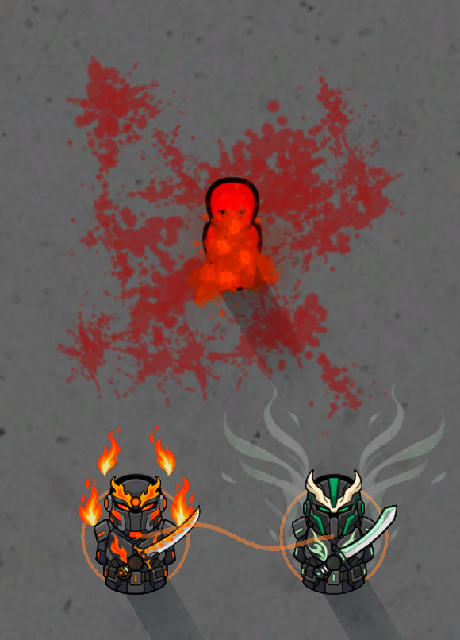

# Allied Ascendant synchronization

*Native in-game capture with a durable test opponent; a visual example rather than a damage benchmark.*

Enabled by default under **Mod settings → Elemental Hearts → Enable allied Ascendant synchronization**. It works through existing elemental attacks and supported counters. It adds no skill-menu buttons and does not take over either pawn's movement or orders.

Two living, awake, transformed Ascendants must strike the **same hostile pawn within four seconds**, stand **within eight cells of each other**, and have clear sight between the participants and the enemy. They must share a faction or be mutually allied; neutral, hostile, prisoner and self-target interactions do not qualify. Disciples do not receive this full Ascendant support system.

The first successful elemental impact primes the enemy. A different eligible allied caster's successful impact confirms synchronization. Ordinary attacks from unrelated systems, cosmetics and environmental damage cannot prime it. Supported non-lethal techniques can confirm through their actual suppression/control instead of injury.

## Bonuses

Both participants gain **10% more melee damage and movement for four seconds**. A Celestial, or an Eclipse currently empowered by a real eclipse, grants a stronger **15%** version. The stronger condition replaces the weaker one; copies never stack.

Each participant has **one shared six-second synchronization cooldown**, regardless of how many allies or enemies are nearby. The pair's effects follow their elemental families, so Azure Flame counts as Flame, Thunderstorm as Lightning, Glacial as Water, Cyclone as Wind and Adamant as Earth.

| Participants | Additional effect |
| --- | --- |
| **Flame + Wind** | Increase **one existing successful injury packet by 15%**. No extra projectile, explosion or damage packet. This is separate from the temporary synchronization stat bonus. |
| **Water + Lightning** | A successful coordinated hit can discharge for **up to one second of stun**. Electrical resistance still reduces it, and the existing shock/recovery condition blocks reapplication or extension. |
| **Either participant is Water** | Repair **up to four points of ordinary injury severity on each participant**, once. No limb regeneration, scar removal or repeated healing ticks. |
| **Either participant is Earth** | Both receive a **15% reduction to remaining incoming damage for four seconds**, with one concord ward per pawn. Existing personal defenses still have their own behavior. |

Lunar and ordinary Eclipse participate in the shared coordination bonus. Celestial and eclipse-empowered Eclipse supply the stronger sovereign version. Same-family allies can synchronize too; the special cross-element reactions require their listed families.

In Non-lethal mode, synchronization retains support and control without creating an extra injury packet. Glacial Explosion's non-injury push/freeze can participate. Returning Tide counters use the same bounded scope and cooldown rules as other supported elemental impacts. Existing automatic-counter enablement still applies.

## Timing, saves and performance

The qualifying hit commits both participant cooldowns immediately. Health buffs, recovery and discharge resolve on the next map tick, outside the damage/health iteration. This avoids changing a health collection while an attack or counter is enumerating it. A participant who despawns, becomes incapacitated, reverts or stops qualifying before resolution cancels that pending support safely.

Primers, cooldowns, pending support and active status conditions survive saving/loading. A confirmed hit does not replay on load. Old cooldown, transformation, mastery, teaching and gear ownership keys are unchanged. Disabling the setting prevents new synchronization; existing short statuses expire normally.

Each map caps its state at **64 target primers, 128 member cooldowns, 24 pending events and 24 transient visual links**. Full cooldown capacity rejects new activations instead of evicting active cooldowns. There are no map-wide target scans or additional damage-spawn chains.

Effects use one cached material, eight cached ribbon-phase meshes, one cached ring mesh and **three draw calls per visible pair**. Links and rings fade after 0.6 seconds, respect effect opacity, and are culled by camera/fog. Existing afterimage/effect pools remain intact. No terrain, weather, buildings, temperature simulation or permanent decals are introduced.
