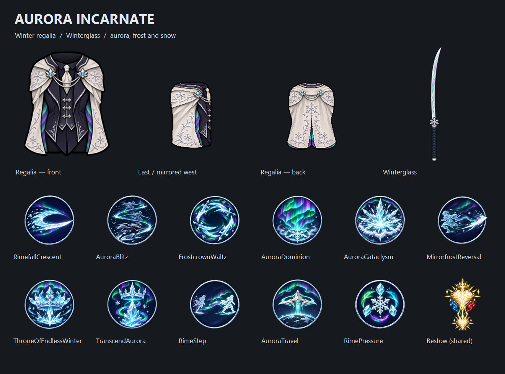

# Aurora Incarnate artwork prepared

The playable third Water stage is **Water → Glacial → Aurora Incarnate**. See [mechanics and save rules](AuroraIncarnate.md) and [the original design plan](AuroraIncarnatePlan.md).

Aurora Blitz supplies rapid enemy-to-enemy slicing with snowy wakes and aurora ribbons. Aurora Dominion is the signature northern-lights curtain ability. Frost, snow, controlled freezing and crystalline shatters preserve the Water/Glacial identity. Anomaly-inspired effects remain reserved for another future element.

Prepared assets: 24 fitted worn textures plus inventory art; Winterglass katana; eleven new command/resource icons and shared Bestow; 196 effect frames in 25 sequences, including a sixteen-frame crown shatter, four-frame outward frost streak and six-frame halo/aura/freeze/snow loops. The new textures have been staged in the mod's Textures folder.

Runtime paths:

- `Things/Pawn/Humanlike/Apparel/AuroraIncarnateRegalia/AuroraIncarnateRegalia`
- `Things/Item/Equipment/WeaponMelee/AuroraIncarnateSword`
- `UI/Commands/ElementalHearts/AuroraIncarnate/`
- `Effects/ElementalHearts/AuroraIncarnate/Frames/`

[Animation specification](AuroraIncarnateAnimationSpec.json) lists frame names/counts and illustrative timing. [Sword landmarks and draft profile](AuroraIncarnateSwordProfile.json) preserve the prepared grip, blade and mirror conventions; the active native weapon profile is registered with the playable Winterglass definition. [Validation](AuroraIncarnateAssetValidation.json) records texture and native-mask checks. Static fitting passed all 32 body/facing comparisons. Native integration also loaded all 196 effect frames and initialized all 32 body/facing combinations, and exercised combat, saving/reloading and group flight. These checks establish asset loading and fitted coverage; see [integration verification](AuroraIncarnateVerification.md) for test scope and remaining visual limits.

The complete local asset pack additionally contains authored source PNGs, exact built-in image-generation prompts, an animated HTML gallery, GIF previews and frame boards. Gameplay source, definitions, assembly and active Melee Animation profiles were left unchanged by asset preparation.
