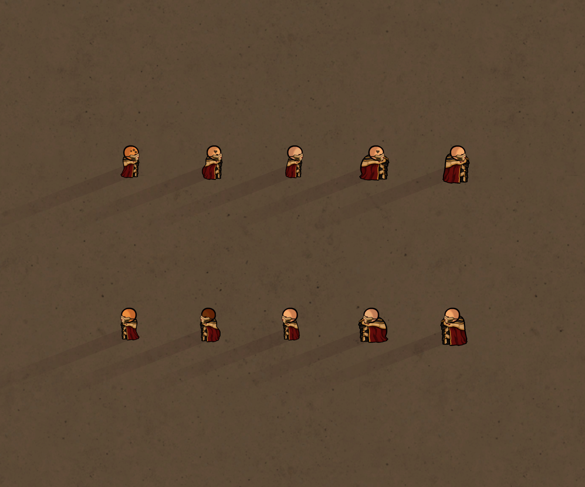
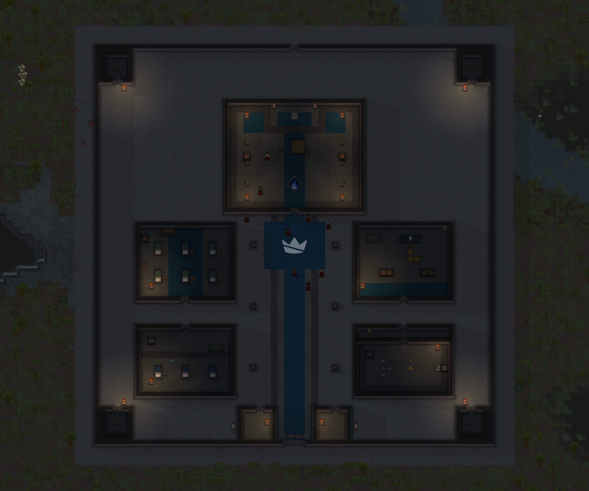

# Herald faceguard and stronghold detail

This update moves the side faceguard to the front of the lower face and gives the five Court strongholds a more detailed command-center layout. It retains their existing combat powers, garrison sizes, finite provisions and campaign rules.

## Faceguard

The ivory plate now projects over the mouth and chin, supported by a short cheek brace and a thin strap behind the head. The east sprite is fitted to native head bounds; west uses RimWorld's normal mirroring. The existing south/north sprites remain in use. Eyes and hair remain visible; the item still mechanically covers the mouth and hides the beard.

Seven-body south/east/north/west fitting previews are also included in [the complete outfit sheet](Images/court-herald-armor-fit.png). Native galleries cover the five adult bodies and available ordinary male/female head shapes. Recruited Heralds still lose the Court faceguard, regain their elemental apparel and retain their bound sword.

## Stronghold layout

Fresh maps have a 59×59 granite perimeter, a double-depth three-door front gate, two gatehouses, four corner watch posts and a rear postern. Courtyard barricades flank the main route. Slate, ivory and lineage-colored carpets, a broken-crown courtyard inlay and the commander's elemental emblem establish the Court's identity.

The hall contains a raised-looking floor pattern, crimson command chair, tactical table, audience chairs, bookcases, standards and braziers. The barracks has six beds with end tables and storage. The infirmary contains three functional medical beds. The armory has shelves, a machining station and a tool cabinet. The treasury gains an internal door and vestibule. Court standards and warm, fuel-free braziers are new generated sprites; brazier illumination uses the native light component without heat simulation or particle spawning.

All five forts share this architecture. Their commander, elemental troops, serum, carpet color, hall emblem and surrounding biome distinguish them. They still begin with one Herald, two Knights and six Oathlings and their original finite treasury.

## Existing saves

The new `EH_holdLayoutVersion` key records the architecture version. All previous save keys remain unchanged.

Already-loaded older strongholds receive an additive interior upgrade once when loaded. It adds furnishings only where their full footprints are clear, preserves pawns and loose loot, and skips player construction and painted floors. It retains the original walls and perimeter. Unvisited or regenerated fort maps receive the complete expanded layout.

Reloading does not duplicate furnishings, defenders or loot. Retreating retains surviving defender identities and unclaimed provisions through the existing native map/settlement holders. Returning does not generate a replacement Herald. Cleared forts remain cleared.

## Verification

The release compiled against the local RimWorld 1.6 and Harmony assemblies and passed **90 native checks** in an isolated save. Checks covered the loaded legacy maps, repeated migration, preservation of player construction, side-mask rendering and redemption, all five new layouts, medical beds, lights and doors, five internal routes per fort, saving/loading, retreat/return, original defender identities, finite treasury and clean combat scopes.

The side-mask/head galleries and new fort layouts were also visually inspected in the native renderer. The integration log contained no missing-definition, missing-texture or exception errors. Temporary verification code and saves are separate from the shipped mod.
