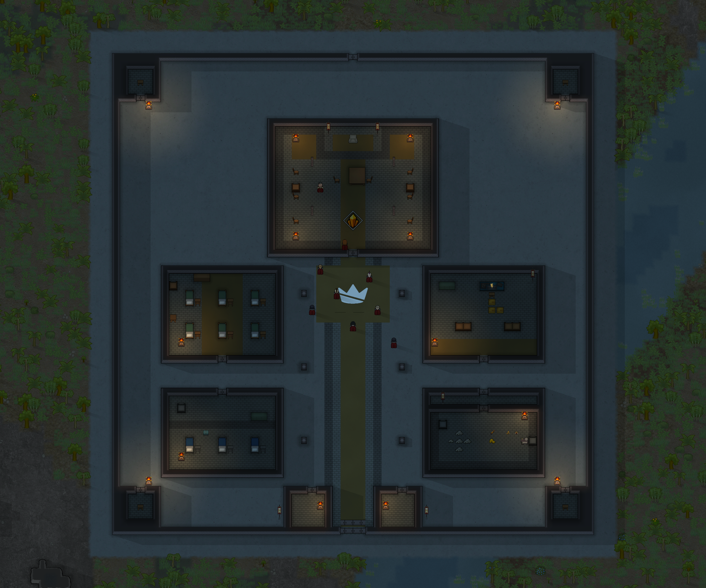
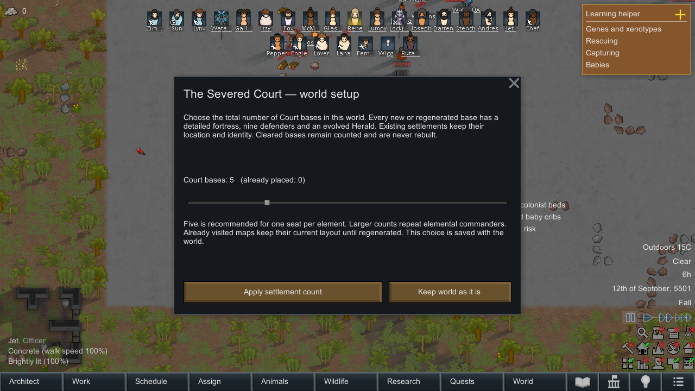

# Court fortresses, world setup and elemental spoils

## Ordinary bases now use the fortress

The previous release only assigned its special generator to `EH_CourtStronghold` world objects. The faction's first settlement and bases created by ordinary world generation remained native settlements. Their standard maps used a points-based settlement group, which could leave only two Oathlings.

Every native Court `Settlement.MapGeneratorDef` now selects the same custom fortress generator. Its initial garrison is one Herald, two Knights and six Oathlings. `CourtSite` provides the shared layout/garrison/provision behavior while preserving the original native world object, tile, ID and external references. Other factions keep their own generators. Both kinds of Court base can dispatch Heralds and appear in dossiers.

Existing named-stronghold fields and save keys remain valid. Native settlements save their new records under `EH_courtNativeBaseRecords`; their reserved provisions participate in native holder traversal. Already-visited standard bases are adopted without destroying their buildings or replacing surviving pawns. On regeneration they receive the new layout while retaining survivors and unclaimed provisions. No dead defenders or taken loot are replenished.

## World setup menu

An older save without a saved choice opens one Court setup window after loading, before any faction/site addition. Choose the total bases to place; five is recommended. A missing faction can remain absent by choosing zero. Existing and already-cleared bases count toward the total. Keep world as it is records no addition; the close button postpones the choice until a later load.

The saved choice prevents repeated popups/additions. Settings → Elemental Hearts → Configure Court settlements in this world reopens the menu. Raising the total adds only the difference, on unused tiles, filling underrepresented elemental commanders first. Lower choices never remove sites. Cleared bases and defeated factions remain cleared. There is no per-tick world scan.

On a new-world initialization with the Court enabled, native faction settlements are brought to a minimum of five, retaining a larger generated count. With the Court omitted during world creation, it remains absent.

## Maximum-budget Heralds

At 10,000 original incident points or above, combat raids guarantee one Herald while Court raids/commanders are enabled and a living, unengaged Court base can dispatch one. The guarantee does not require day 60. Below the maximum tier, the existing day-60/8,000-point 18% roll remains in effect.

The original budget is carried through native point adjustments in a temporary context that unwinds on completion or exceptions. Generated forces stay within their final budget and sixteen-pawn limit. A forced ordinary story recovery, noncombat group or forced-downed group receives no Herald. Clearing every Court base ends Herald dispatches.

## Essence and sigils

| Fallen hostile Court rank | Matching essence | Additional material |
| --- | --- | --- |
| Oathling | 1–2 | — |
| Knight / awakened ordinary Ascendant | 3–4 | — |
| Herald | 6–8 | One Herald crucible sigil |

Items drop near the death on a loaded map. A per-pawn `EH_courtSpoilsClaimed` key is committed before spawning the bounded one/two material stacks. Revival and save/load cannot replay a drop. Pre-update dead pawns default to claimed; redeemed colonists are excluded. Off-map deaths do not spawn remote items.

Five essences share one generated neutral crystal sprite with native elemental material colors. Herald sigils reuse the existing Court seal. They are crafting resources, not equipment or usable power grants.

| Drug-lab recipe after Fabrication, Crafting 8 | Ingredients | Product |
| --- | --- | --- |
| Condense matching elemental serum | Eight matching essences, two industrial medicine, one industrial component | One Flame / Lightning / Water / Wind / Earth serum |
| Refine Herald sigil | One sigil | Four essences of the chosen ordinary element |

The ten recipes supplement existing serum recipes. Fresh fortress treasuries also hold twelve matching essences and one sigil. Existing treasuries are not refilled. No Celestial, Lunar or evolution serum is added.

## Two new encounters

**The Severed Crucible:** from day 30, secure twelve matching essences and one sigil from a damaged tracked cache. Acceptance reserves one warned ordinary recovery raid for one day later, capped at 3,600 points with no Herald. Ignore/expire for no reward and no pursuit. Twenty-day cooldown.

**The Herald's Ultimatum:** from day 60 and 8,000 points, a surviving commander announces a two-day expedition. Pay six matching essences and 600 silver to cancel that exact expedition, or defy it and face the Herald-led attack. Payment consumes visible, unforbidden resources on that map and does not alter hostility. Attacking or clearing the origin recalls the expedition. Thirty-day cooldown.

The existing two-order bound, native raid arrival, story settings and cooldowns apply. Choice state, element, unique order ID and origin are saved. The old `CourtOrder.origin` field and `stronghold` save key remain available; native base origins use a separate `settlementOrigin` key.

## Native verification

**143 checks passed:** 112 campaign/loot/recipe/event checks, 24 pre-Court/zero-choice/world-initialization/dispatch/refusal checks and seven final defeated-faction/source-gating/save-state checks. The menu was visually inspected in the running game's native interface.

The tests entered an ordinary native Court settlement through `GetOrGenerateMapUtility`, proving the actual map-generator route produces the detailed layout, nine defenders and one Herald without changing its world-object ID. Native faction creation and `WorldComponent.FinalizeInit(false)` exercised the new-world initialization path, including the factory-created first settlement. This is a lifecycle integration test on an isolated world; it does not automate the full new-game planet-creation interface.

Other checks covered the selected settlement total, explicit zero, repeated application, all five materials and ten recipes, all three ranks' matching death loot, native resurrection, claim persistence, maximum-budget native raid arrival, disabled commanders, both event choices and saved pending orders, exact tribute consumption, native-origin recall, retreat/return with original defenders, removed-loot preservation, defeated-faction exclusion and clean raid/combat scopes. Integration logs contained no exception, missing-definition or config errors. The isolated test mod and saves are outside the shipped mod.
