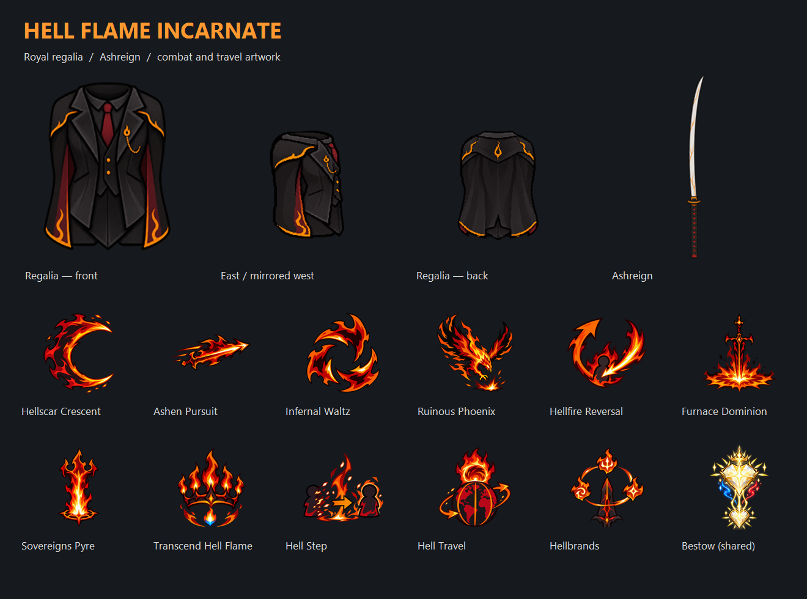

# Hell Flame Incarnate — integrated artwork

The third Flame form is implemented with seven combat forms, transcendence, shared transformation/reversion and Hell Step/Travel. See [the gameplay guide](HellFlameIncarnate.md).

The reworked outfit is a black tailored suit and compact black/crimson-lined cape. Ashreign is a curved ivory katana with a black/crimson grip and orange etching. Includes seven native bodies × south/east/north with mirrored west, three FemaleBB compatibility textures, inventory icon, Ashreign sword, eleven new command icons, shared Bestow, and 146 effect frames. Native geometry checks cover 32 body/facing combinations with zero uncovered native-body pixels. Main effects are 512×512; loop/apparel/command/equipment textures are 256×256. Native game checks cover transformation, gear identity, combat and travel; custom race renderers outside the supported bodies may require their own fitting.

Paths use `HellFlameIncarnateRegalia`, `HellFlameIncarnateSword` and `Effects/ElementalHearts/HellFlameIncarnate/Frames/`. See [the animation contract](HellFlameIncarnateAnimationSpec.json) for exact names, frame counts, pivots and directions. [Generation prompts](HellFlameIncarnateGenerationPrompts.json) record the built-in image generation and selected sources; full source artwork and previews are in the local Hell-Flame-Incarnate-Assets pack.

The uniform covers Torso, Shoulders, Arms, Hands, Waist, Legs and Feet through its actual apparel definition. Shared indestructible bound equipment and manifestation/reversion remain integrated. Halo and subtle back aura appear while transformed, drafted and standing. Alpha-capable materials retain black flame detail. The fitted Melee Animation profile is installed with the new weapon definition.

Effects use bounded pools/afterimages, cached materials, camera/fog culling and bounded local searches. Code owns damage/knockback and saved impact commitments; frame playback is visual only. Hell Step/Travel uses Thunder's corrected Auto → Manual → Travel control cycle and safe targeting/transit handling, with dedicated infernal textures and jobs.
