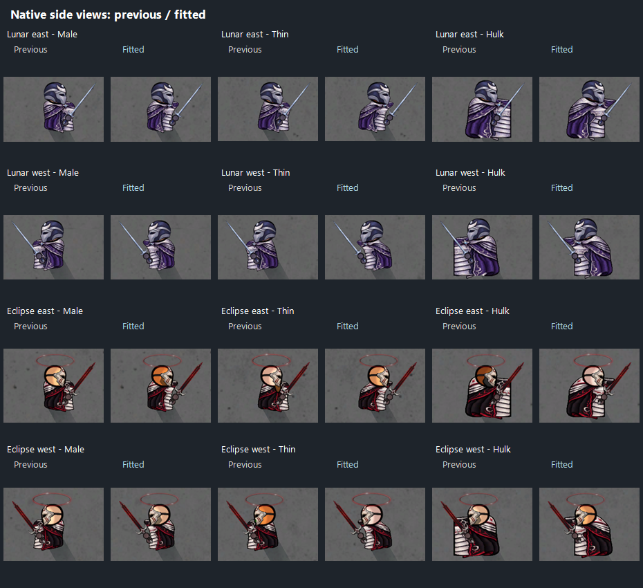

# Lunar/Eclipse side fit and Adamant tier correction

## Side apparel

The east-facing Lunar and Eclipse torso silhouettes are narrower through the body and registered to the native torso instead of the old forward-heavy padding. The upper collar anchor stays in place, keeping the helmet/head relationship intact. West uses native mirroring of the same east graphic.

Fourteen east sprites cover Male, Female, Thin, Fat, Hulk, Child and Baby. Front/north apparel, masks, halos, sword presentation and native body/head positions are unchanged. The cloak design and existing approved palette are retained. The exporter re-registers that artwork to the new silhouette while retaining opaque coverage of the native body; it does not draw exposed skin or painted limbs.

The fitting report records torso registration and collar drift per body. Twenty-eight east/west native-alpha coverage checks pass with no uncovered required pixels. The in-game comparison renders five adult body textures in east/west poses; Child/Baby coverage is verified against their age-correct native textures without treating babies as standing combatants.

The mean torso-width reduction is approximately **12–16%**, depending on body texture. Overall image bounds also include the retained shoulder/collar position and recentered cloak, so the width of the image's bounding rectangle alone is not the torso-width measurement.

## Adamant

Adamant shares the ordinary evolved tier with Azure Flame, Thunderstorm, Glacial and Cyclone. Eclipse and Celestial retain their higher combat tiers.

| Property | Previous Adamant | Current Adamant |
| --- | --- | --- |
| Melee damage stat factor | ×2.8 | **×2.2** |
| Melee cooldown factor | ×0.65 | **×0.7142857** |
| Incoming damage factor | ×0.08 | **×0.10** |
| Bound sword point/edge power | 30 | **23** |
| Bound sword handle power | 10 | **9** |
| Ordinary injury recovery | 3/s | **2/s** |
| Wound sealing delay | 150 ticks | **180 ticks / 3 seconds** |

The 500% movement factor, +50 mood, five techniques, Resolve, Bulwark, stone resistance, indestructible gear, carrying/travel benefits and Bestow remain. Earth/Adamant keeps its defensive identity rather than gaining a higher general damage/recovery tier than Eclipse. No normal Earth, disciple or Eclipse/Celestial base values are nerfed.

These are definition changes, so existing saved Adamants and Worldbreakers receive them after restarting with the new build. Their saved lineage, sword quality, mastery, cooldowns, personal gear and transformation state are retained.
