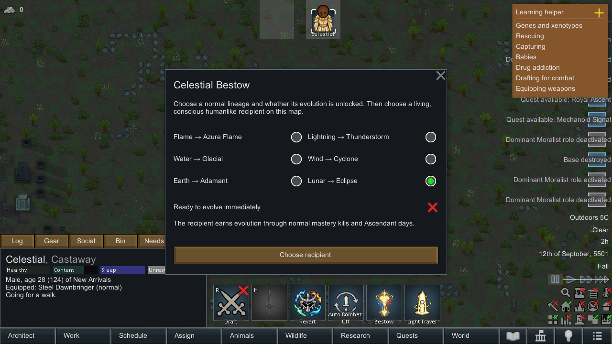
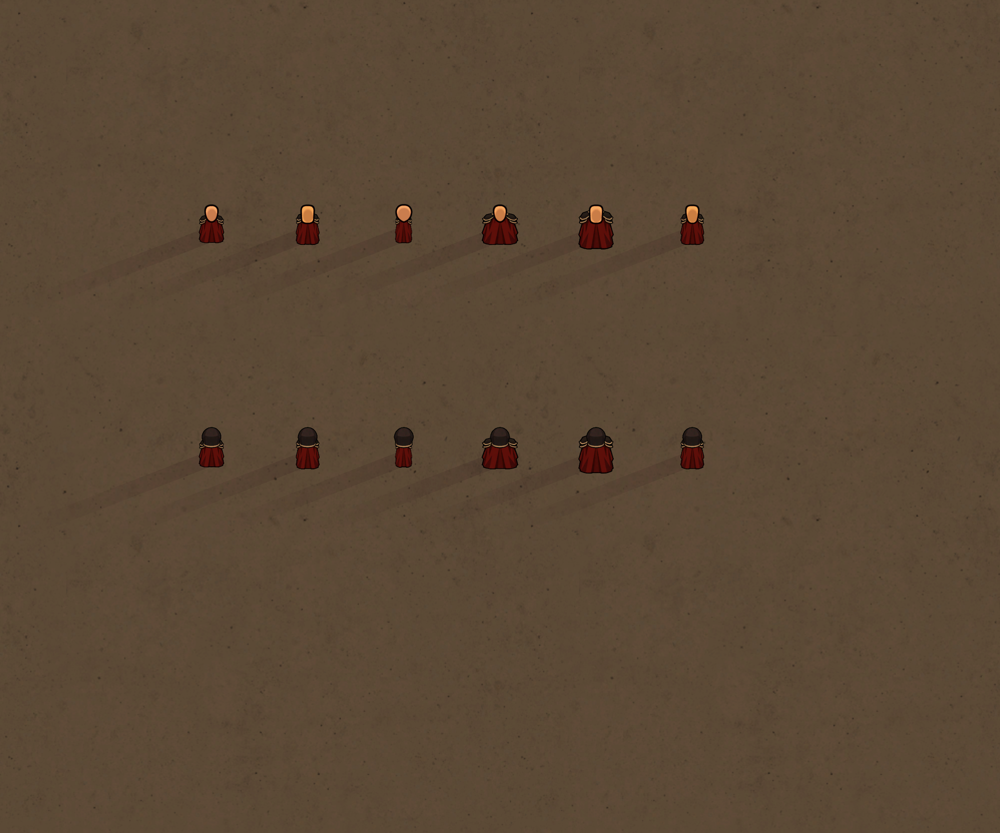

# Celestial travel, chosen Bestow and Court battle behavior

## Light Travel

The default command prepares the chosen world map and finds a safe landing before the Celestial departs. Arrival is automatic. Right-click offers precise placement and same-map relocation; canceling precision leaves the pawn at the origin. A blocked chosen cell receives a nearby safe fallback. Terrain/occupant checks reject walls, fire, traps and fogged cells; the fallback search is capped at 640 nearby cells and 2,048 map samples.

Departure/arrival last 42/24 ticks. Requests from pause run the short native job animation and restore pause. Saved jobs retain their destination, chosen cell, progress and pause request. Automatic in-transit saves resume landing even when paused. Old manual travelers retain recovery controls. The same pawn, inventory, bound sword and transformation cross maps; there is no cost or cooldown.

Existing maps, land and impassable mountains on the same world layer are valid. Empty ocean tiles remain unavailable. Temporary destination maps cannot be removed while planning, departing or carrying the passenger. Ordinary empty maps can still unload after travel is over; revisiting a cleared settlement does not resurrect its defenders or stronghold.

## Celestial Bestow

One Bestow command opens a configuration window. Choose Flame, Lightning, Water, Wind, Earth or Lunar, and toggle Ready to evolve immediately. Choose recipient then starts normal target selection. The chosen configuration belongs to that job; changing the saved menu preference cannot change an ongoing ceremony.

Conscious, living humanlike recipients can include prisoners and enemies. The gift preserves faction/status and cannot add a second lineage. A four-second paired ceremony keeps both pawns facing each other. Interruption grants nothing and releases both participants. Evolution readiness unlocks the normal Evolve button without performing evolution. With readiness off, mastery kills/time are earned normally. Other evolved givers keep their existing matching-element Bestow.

The old selected-outcome key remains valid. In-progress legacy ceremonies preserve their already-rolled result and readiness. Menu preferences and the new readiness field have separate saved keys. No new combat gizmo is added.

## Court clothing and challenge

The seven standard body textures are reused through an explicit body-compatibility mapping. FemaleBB and similar custom bodies use a fitted native counterpart for Court uniforms and manifested Court armor, including north-facing graphics. The pawn's real body remains unchanged. Afterimages use the same mapping.

Court ranks receive better native melee training and stand their ground. Bounded local tactics keep them engaged after skills, prioritize combat threats, support leaders' focus, and limit pressure to avoid every warrior choosing the same target. The thinker respects active techniques, rituals, external animation ownership and player control.

A temporary nonstacking formation grants 12% damage resistance and 8% faster movement to an engaged warrior with three nearby active Court comrades. Separation, captivity, downing, redemption or disabling the setting removes it. Natural expiry prevents a stranded permanent bonus. The setting is enabled by default.

Native group budgets, bounded effect pools, skill cooldowns, one-hit rules, elemental tiers and existing loot/settlement persistence remain in force. An intercepted Earth impact returning a null damage result is now treated as no damage instead of throwing, avoiding an interrupted Earth skill under compatible damage/parry mods.

## Otherworld Calling

This utility is planned separately: a normal human colonist would arrive through a solar passage, with no elemental power until Bestow. [Proposed mechanics](OtherworldCallingPlan.md). It is not presented as a shipped summon command in this update.

## Verification

The mod compiled against the installed RimWorld 1.6 and Harmony assemblies. **121 native checks passed** with Humanoid Alien Races, FemaleBB BodyType Support and Melee Animation enabled: 112 body/Bestow/tactics/travel checks and nine additional interruption, local relocation, arrival-save and damage-interception checks. A focused replay from a saved departure checkpoint also completed with no exceptions, unresolved references or config errors after cleaning stale references in the test companion's own saved state.

Checks covered north materials and galleries across five standard adult bodies plus real FemaleBB for both ordinary ranks; all six Bestow elements with both readiness settings; hostile/prisoner gifts and preserved allegiance; no second lineage; active paired ceremony saving/loading; interrupted ceremonies; formation engagement, nonstacking, recruitment and settings cleanup; destination preparation before departure; canceled precision; occupied-cell fallback; same-map relocation; departure/transit/arrival saving/loading; paused recovery; exact sword ownership; released skill gates; and a mod interceptor that returns a null Earth damage result. Temporary travel/ritual/combat state ended cleanly.

The running game's Bestow menu and its real right-click Light Travel options were visually inspected. The Bestow screenshot is included above. The test companion and isolated saves are separate from the shipped mod. Existing UI command counts and bounded local effect pools are preserved.
