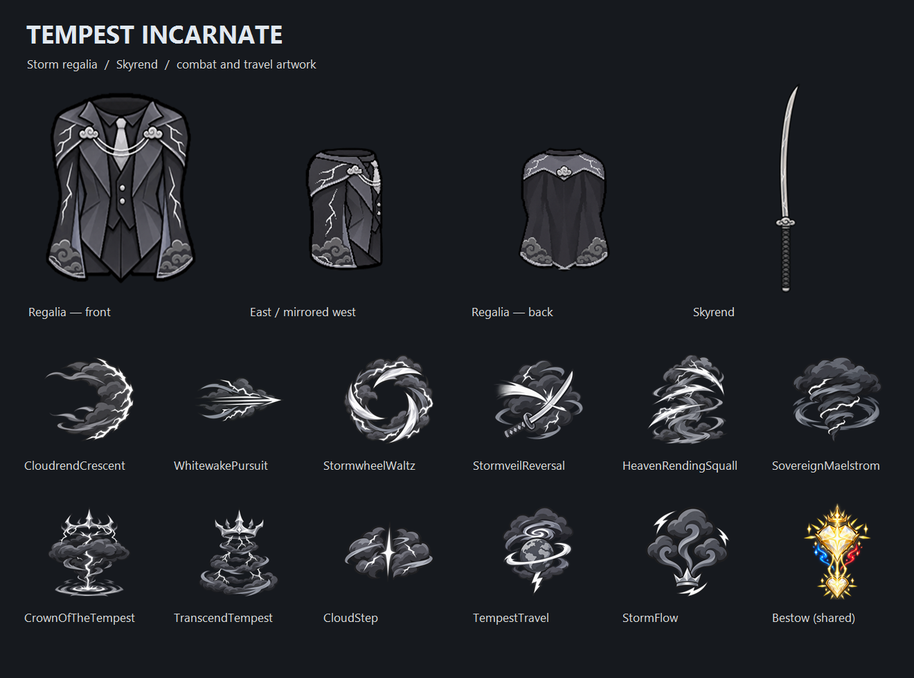

# Tempest Incarnate — asset pack

Dark storm-grey clouds and white electricity for **Wind → Cyclone → Tempest Incarnate**. Artwork is installed and the playable lineage is implemented. See [Tempest Incarnate mechanics](TempestIncarnate.md).

## Contents

- 24 fitted worn textures: seven native bodies plus FemaleBB, each in south/east/north with native west mirroring; one inventory icon.
- Skyrend katana: fitted upright source, measured grip/blade landmarks and a registered native Melee Animation profile.
- Seven combat icons: Cloudrend Crescent, Whitewake Pursuit, Stormwheel Waltz, Stormveil Reversal, Heaven-Rending Squall, Sovereign Maelstrom and Crown of the Tempest.
- Transcend, Cloud Step, Tempest Travel and Storm Flow icons; existing Bestow icon reused.
- **178 effect frames across 23 sequences**: twenty eight-frame combat/utility sequences and three six-frame halo, back-aura and airborne-ribbon loops.
- `Preview.html`: local animated gallery with play/pause, speed, background and size controls. `Previews` contains still overview, complete frame boards and the 32-case body-fitting board.
- `AnimationSpec.json`, `GenerationPrompts.json`, `Sword-Landmarks.json`, validation files and a SHA-256 manifest.

There are **216 runtime PNGs**. Attack/utility frames are 512×512; loops, apparel, icons and equipment are 256×256. All runtime files have genuine RGBA transparency and clear outer borders. Frame suffixes begin at `_00`.

## Fitting and equipment

The charcoal tailored royal suit has a close-fitting split storm cape, silver cloud clasps, low collar, flat chest and white lightning seams. Native geometry checks cover all seven body types plus FemaleBB in south/east/north and mirrored west: **32 checks, zero uncovered native-body pixels**, with collar centring within three texture pixels. All supported bodies use the native head origin; no extra head lift is requested. Child/Baby entries are texture-fit previews, not claims of developmental-stage combat support. Native game rendering and Melee Animation are verified during integration; the generation-time fit measurements remain recorded below.

The installed apparel definition explicitly covers **Torso, Shoulders, Arms, Hands, Waist, Legs and Feet**. PNG coverage alone cannot grant mechanical groin/limb coverage. Keep the established indestructible bound-gear system, personal-clothing restoration on reversion/downing, and sword identity through recovery. No helmet is included.

Skyrend has a charcoal wrapped grip, compact silver cloud guard and pale curved blade with white electrical etching. Its source curves to the right in the same convention as the corrected Thunder/Hell katanas. The hand anchor is registered at texture X=128 within half a pixel. The prepared Melee Animation profile uses scale 1.38, a 90-degree local rotation, measured blade limits and FlipY=true. Native held rendering should use the shared 90-degree equipped angle and held-edge UV correction. The profile is installed for the playable `EH_TempestIncarnateSword` and uses the shared held-edge UV correction.

## Effect and animation contract

Each sequence is exported from a common atlas-cell window and scale, retaining its authored growth/fade. C# owns smooth translation, rotation, frame cross-fades, effect opacity, action timing, targeting, damage and saved impact commitments. Use the pivots/timing in `AnimationSpec.json` as integration guides and validate the final world-space anchor in game.

- Cloudrend/Whitewake face right along texture +X; rotate into the aim direction. Keep the crescent's sharp convex leading edge forward.
- Stormwheel has eight distinct spinning phases. Parry and counter have separate sequences; Squall has rising and finishing layers.
- Maelstrom has formation, looping hold and release sequences. Use the small shared airborne ribbon loop around each captured pawn. Draw the main funnel behind bodies or at restrained opacity so targets remain readable.
- Crown has a telegraph, upright funnel and expanding pressure burst. Its pictures never cause repeated damage. A large funnel is a visual layer, not a spawned tornado pawn/building.
- Cloud Step, travel departure, arrival, ring, motes, transcendence charge and ordinary melee clash have dedicated sequences.
- Halo/back aura use six gentle looping phases with empty centres. Show only while transformed, drafted, standing and awake. Keep the back aura around 0.25–0.35 opacity and behind the pawn.
- Grey clouds need alpha-capable transparent materials; purely additive rendering loses dark shapes. Materials should be cached once. Reuse bounded local effect/afterimage/capture pools, camera/fog culling and short visual lifetimes.
- Floor wisps/rings are temporary visuals. Avoid spawned tornado entities, terrain changes, roof removal, building damage, global weather/temperature changes and uncontrolled projectiles or extra damage packets.

The planned utility button uses **Step: Auto → Step: Manual → Travel** on right-click. Manual/Travel disable automatic stepping. Step targets a safe map cell; Travel uses the shared exact world/cell picker and original-pawn transit handling. Reuse Auto Combat/Off/Non-lethal, the fixed combat-order handling and the existing Bestow icon. C# must preserve interruption cleanup, capped captures, target-side control recovery and saved per-impact hit commitments.

## Source and status

All new artwork was made with the **built-in image generator**. The complete prompt set, reference roles and selected source files are in `GenerationPrompts.json` and `Generated`. Rejected earlier variations are retained under `Generated/Drafts`. Export preparation uses the project's existing native-body fitting and atlas-slicing tools; the pack does not redistribute game/dependency assemblies or raw native body/head textures.

Only the new texture namespaces and asset documentation are staged in Elemental Hearts. No Tempest abilities, hediff, evolution button or gameplay definitions are activated by this asset pack. Existing gameplay source, definitions and assembly hashes remain unchanged.
