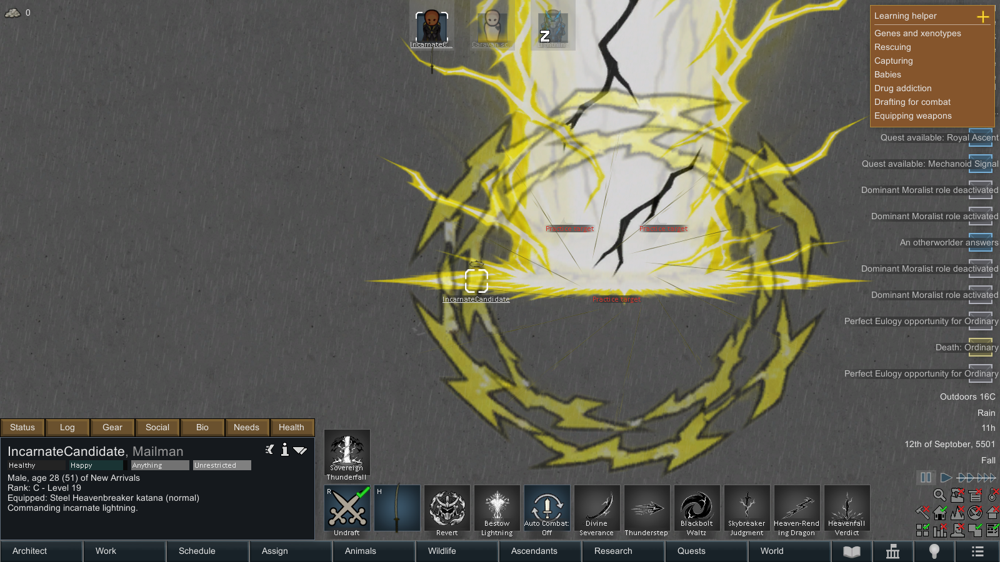
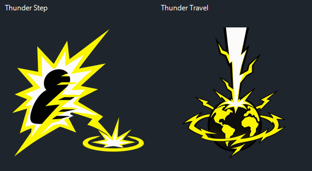
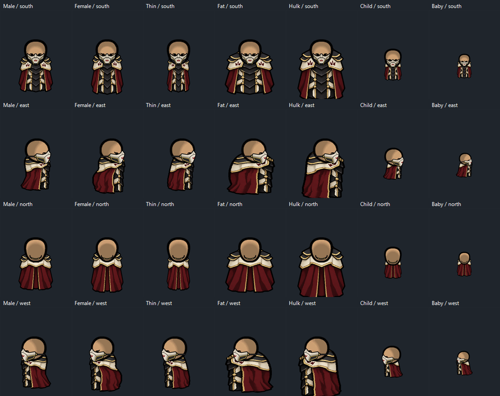
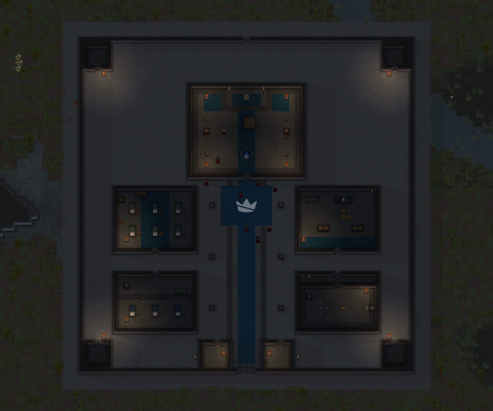

# Elemental Hearts

**Ascend. Teach. Evolve.** A sword-combat and progression mod for **RimWorld 1.6**.

Turn humanlike pawns into elemental warriors with permanent powers, bound swords, indestructible manifested armor and animated combat forms. Train disciples, earn an evolution, or choose a lineage through a Celestial's Bestow. Fight manually or let Auto Combat chain techniques, counters and finishers.

This is an intentionally powerful, anime-inspired mod. Ordinary Ascendants exceed vanilla fighters; evolved lineages add stronger defenses and advanced techniques, while Celestial and Thunder Incarnate occupy the sovereign tier. Eclipse matches their core combat tier during a real eclipse.


*Staged in-game roster of the original thirteen forms; Thunder Incarnate is shown below. Top row, left to right: Lightning, Flame, Wind, Water, Earth. Middle: Thunderstorm, Azure Flame, Cyclone, Glacial, Adamant. Bottom: Lunar, Eclipse, Celestial. Screenshots use an isolated showcase save and the optional Melee Animation integration.*

## Ascendant Codex and squad controls

Open **Ascendants** on the bottom toolbar to manage your disciples, all fourteen forms and recognized Otherworlders across maps and caravans. Search/filter the roster, inspect real kill/day progress, locate pawns and start their existing Ascend/Evolve ceremonies when eligible.

Select multiple rows for **Auto: On**, **Auto: Off**, **Non-lethal**, **Transform** or **Revert**. Group transformations use the normal animations and report pawns skipped because they are busy, incapacitated, off map or have queued orders. These controls occupy their own window, keeping individual skill menus readable. New summons retain their otherworld origin after Bestow; older summons are recognized when their school uniform and ISEKAI identity provide evidence. See [the Codex guide](Docs/AscendantCodex.md) for selection, safety and existing-save details.

## Thunder Incarnate

**Lightning → Thunderstorm → Thunder Incarnate.** Earn **300 new credited hostile non-animal kills and 15 days as Thunderstorm**, then begin the free eight-second **Transcend** ceremony. This is a separate third-stage mastery counter; existing Thunderstorms start it when the update loads. The Ascendant Codex tracks readiness, and **God Mode** exposes **DEV: Transcend-Ready** to unlock the normal ceremony.

Thunder Incarnate matches Celestial's core damage, defense and recovery. Healthy native capacities show **Moving 650%, Consciousness 200%, Manipulation 300%, Sight/Hearing 250%**, with **+75 mood**. Its black princely suit, compact modern cloak, white-bladed Heavenbreaker katana, storm crown and animated lightning back aura give it a distinct black/yellow silhouette.

| Combat form | Behavior | Base cooldown |
| --- | --- | --- |
| **Divine Severance** | Broad ranged sword crescent through a clear lane; applies Charged. | 3 s |
| **Thunderstep Strike** | Checked dash to an adjacent landing and a focused katana strike. | 3.5 s |
| **Blackbolt Waltz** | Eight-cell spinning storm that consumes caster-owned charges. | 6 s |
| **Skybreaker Judgment** | Fast approach, visible warning, heavy contact strike and five-cell corona. | 13 s |
| **Heaven-Rending Dragon** | Up to ten distinct enemies connected by straight zigzag dash legs. | 15 s |
| **Heavenfall Verdict** | Aerial rush into an eight-cell landing shockwave. | 22 s |
| **Sovereign Thunderfall** | A colossal lightning-filled pillar and ten-cell AOE, capped at 32 eligible hostiles. | 40 s |

Changing committed forms builds **Storm Dominion**. A fully charged Judgment, Verdict or Thunderfall gains **20% ability damage** and a short extra defensive ward. Shared **Auto Combat / Off / Non-lethal** controls apply; cooldowns are spent on a valid start, including interrupted casts. Saved impact rules prevent animation frames from repeating hits. [Full mechanics and save compatibility](Docs/ThunderIncarnate.md).



*Native in-game capture at peak discharge. Staged opponents allow the animation to be shown; this is not a damage benchmark.*

### Thunder Step and Thunder Travel

One shared utility button keeps the skill menu compact. **Right-click cycles Step: Auto → Step: Manual → Travel → Step: Auto.** Manual and Travel both turn automatic map stepping **off**.

| Button mode | Left-click | Shift + left-click |
| --- | --- | --- |
| **Step: Auto** | Turn automatic stepping off. | Choose a manual map-wide blink. |
| **Step: Manual** | Turn automatic stepping on. | Choose a manual map-wide blink. |
| **Travel** | Choose a world tile, then click the exact landing cell on its map. | Use quick automatic world landing. |

Map stepping ignores sight, fog and range, costs no resources and has a **one-second recharge**. Its destination must be empty and walkable. Auto Step defaults on independently of Auto Combat and follows work/movement routes while retaining current jobs, queued orders and carried items or passengers. Put down carried things before world travel; Thunder Travel has **no fuel cost, distance charge or cooldown**.

The world landing picker pauses safely, opens near usable central terrain and marks valid cells **yellow** or blocked cells **red**. Canceling before confirmation returns to the original map, camera zoom and time speed with the pawn still at the origin. Active encounter maps stay reserved during departure. Loaded maps skip redundant loading; fresh tiles use RimWorld's normal generation once. If an exact cell becomes blocked, the picker reopens instead of silently landing elsewhere. In-transit recovery retains the original pawn and offers landing/return controls. Drafted state, personal gear, bound sword ownership and exact intent survive the saved travel phases.



*Command-art preview. Step blink and ordinary melee clashes each have eight animation frames; the subtle back crest has six. Cached materials, bounded pools and camera/fog culling also cover these effects.*

The katana's cutting edge is fitted in both native held rendering and optional Melee Animation, retaining its tip direction and hand anchor. Side-view head/hair alignment is adjusted across the supported body textures; Fat/Hulk cloaks retain their slimmer fit. The crown and back aura appear while transformed, drafted, standing and awake.

Lethal techniques can **blast nearby scenery and leave ash and native fires**. These are bounded committed effects, separate from the technique's saved pawn impacts. **Non-lethal** disables scenery explosions and ignition; **Mod settings → Thunder Incarnate scenery damage and fires** can disable them entirely. Native fires follow RimWorld's normal behavior. Ordinary melee lightning is visual only and does not add extra hits or structural blasts.

## Otherworld Calling

Celestials can call one permanent human colonist for **1,000 silver**. Choose a safe cell and complete a three-second solar doorway ceremony. Recruits are **18–24**, with Male/Female/Thin bodies only: men wear the fitted boys' gakuran, women the fitted schoolgirl sailor uniform. No Fat or Hulk recruits.

With **ISEKAI RPG LEVELING** enabled, every traveler brings one powerful identity (Summoned Hero, Protagonist or Regressor) and two compatible talents. They receive elemental powers separately through **Bestow**. Missing ISEKAI support disables this command without affecting the rest of the mod. One in-game hour cooldown by default; change it to 0–24 in-game hours in mod settings.

Silver is reserved from reachable, visible, allowed silver anywhere on the current map, including loose stacks outside storage/home areas, returned for pre-commit interruption and consumed once for a committed arrival. Saving/loading retains the same person, traits, money and cooldown. A saved recovery letter handles blocked paid arrivals. Existing one-day cooldowns migrate using the original cast time. Celestial Bestow now uses colored lineage cards, evolution previews and separate mastery/readiness choices. See [the full Calling guide](Docs/OtherworldCalling.md).

## Download and installation

1. [Download the current mod as a ZIP](https://github.com/ZegionV2/ElementalHearts/archive/refs/heads/main.zip), or clone this repository.
2. Extract it into RimWorld's `Mods` folder. Rename `ElementalHearts-main` to `ElementalHearts` if needed.
3. Check the layout: `Mods/ElementalHearts/About/About.xml`. `Assemblies`, `Defs`, `Textures` and `Sounds` must sit directly inside `ElementalHearts`.
4. Enable **Harmony**, then **Elemental Hearts**, and restart RimWorld.

**Required:** RimWorld **1.6**, Core and [Harmony](https://steamcommunity.com/sharedfiles/filedetails/?id=2009463077). **No DLC required.** The compiled mod is included; players do not need to build it.

**Optional:** Melee Animation supplies its native sword animation system; Search and Destroy supports approach/combat behavior. Compatible sword profiles are included. Milira, VEF and Demon Summoning are not dependencies.

To update, close RimWorld and back up your save. Replace the mod with the complete new folder, keep only one enabled copy, and restart after replacing assemblies or textures.

## Enemy faction: The Severed Court

An authoritarian order of elemental sword warriors with shared obsidian/ivory armor, crimson cloaks and a broken-crown insignia. **The Court fields Oathling disciples, normal Court Knights and five evolved Heralds** across Flame, Lightning, Water, Wind and Earth. Their Severed Oath trait changes transformed apparel while preserving elemental powers, armor stats and bound swords. Recruited members renounce the oath as redemption and regain normal elemental apparel, keeping their powers and bound sword. Already-recruited pawns are corrected when loading older saves.

Azure, Storm, Frost, Gale and Adamant Heralds wear shared elite obsidian/ivory regalia, crimson cloaks and open-brow faceguards. Each keeps the appropriate evolved sword, five techniques, stats and combat halo. Ten native Court backstories give the new ranks and deserters their own histories.

Element icons appear beside native map names and update on awakening/evolution. Ordinary walking raids begin from day 30. From day 60 and 8,000 points, smaller eligible raids can roll one Herald; **10,000-point or larger Court combat raids guarantee one Herald**, provided Heralds are enabled and a surviving, unengaged base can dispatch one. All squads remain capped at sixteen and within their actual points budget. Clearing Court bases stops their Herald dispatches.

**Every Court settlement uses the detailed fortress generator**, including the native first settlement and ordinary bases placed during world generation. Each fresh base starts with one Herald, two Knights and six Oathlings. Send a caravan and choose Attack to enter its command hall, barracks, infirmary, armory and finite treasury. Existing native world-object IDs, quest references and other factions are preserved. Visited maps retain their current buildings until regenerated and keep their surviving defenders; troops and taken loot are not replenished.

When loading an older save, a **Court settlement setup menu** appears once before adding bases. Choose a saved total, including zero when no Court is present. Five is recommended; larger totals repeat the five elemental commanders. Existing and cleared bases count toward that total. **Mod settings → Elemental Hearts → Configure Court settlements in this world** reopens the menu to increase it. New worlds with the Court enabled use five bases by default, retaining any larger native-generated count. Repeated loading never adds replacements or recreates a defeated faction.

Court stories include Herald's Writ, Broken Oath sanctuary offers, dedicated Herald assaults, Stronghold Dossiers and two new encounters: **The Severed Crucible** offers serum materials with an explicit one-day recovery pursuit; **The Herald's Ultimatum** lets you pay a tribute to recall one announced Herald expedition or defy it and prepare for its two-day arrival. Choices, cooldowns, origins and pending attacks persist through saving/loading. Lunar/Eclipse Court bosses remain planned. [Roster, settings and integration details](Docs/SeveredCourt.md).

Hostile Court deaths leave matching **elemental essence**: Oathlings drop 1–2, Knights 3–4 and Heralds 6–8 plus a **Herald crucible sigil**. At a drug lab after Fabrication, eight matching essence, two industrial medicine and one industrial component make that element's serum. A sigil refines into four essences of your chosen ordinary element. Loot claims persist through resurrection and saves; redeemed colonists are excluded. [Loot, recipes and campaign changes](Docs/CourtEnemyUpdate.md).



*Herald asset fit preview: south/east/north and native mirrored west, across all seven body textures.*

The Herald side faceguard now sits over the mouth and chin, with a thin rear strap and an open brow. Strongholds feature a double-depth gate, four corner watch posts, two gatehouses, lineage-colored ceremonial paths and a furnished command dais. Court standards, warm braziers, barracks furniture, a medical ward, an armory and a treasury vestibule give the forts a shared command-center identity.



*New or regenerated stronghold maps use the full 59×59 layout. Already-loaded forts receive an additive interior upgrade on loading; their existing perimeter, defenders, provisions and player construction are preserved. [Faceguard, architecture and verification details](Docs/CourtDetail.md).*


## The complete playable roster

All forms below are implemented. Ordinary elements have four combat techniques, their evolutions five, Lunar five, Eclipse/Celestial six, and Thunder Incarnate seven. Transform, Teach/Bestow, automation and travel are additional commands.

| Normal lineage | Combat identity | Evolution | Evolved identity |
| --- | --- | --- | --- |
| **Lightning** | Sword cuts, electrical shocks, charges and counters | **Thunderstorm → Thunder Incarnate** | Crimson zigzag chains evolve into seven grand black/yellow forms, Celestial-tier core strength, Storm Dominion and Sovereign Thunderfall |
| **Flame** | Thermal sword forms, Cinder Step, Inferno Waltz and Phoenix Descent | **Azure Flame** | Blue fire, larger wheel attacks and Azure Reversal's retreat/counter-rush |
| **Wind** | Dust-Cutting Draw, Rising Gale, Turning Swallow and Mountain-Scouring Tempest; Flow rewards varied forms | **Cyclone** | Vacuum Draw, Skyward Gale, Cyclone Reversal, Heaven-Rending Tempest and Sovereign Cyclone |
| **Water** | Torrent Cleave, Flowing Step, Whirlpool Dance and Ocean's Judgement; Pressure and frontal parry/counter | **Glacial** | Glacial Crescent, Frostwake Step, Crystal Vortex, Absolute Zero and Glacial Explosion |
| **Earth** | Faultline Cleave, Stonebreaker Advance, Seismic Quake and Spire Eruption; Resolve supports impact and defense | **Adamant** | Adamant Severance, Mountain King's Advance, Sovereign Quake, Worldspine Eruption and Adamant Bulwark |
| **Lunar** | Five swift moonlit sword forms, Moonbrands and a pressure-triggered retreat/rush | **Eclipse** | Six black/crimson forms, Eclipse Brands, rear strikes and actual-eclipse empowerment |
| **Celestial** | Standalone sovereign: six solar/light forms, Radiance, Fake Rainbow and free Light Travel | — | Already fully evolved; no normal Celestial or Celestial disciple stage |

Normal kits have elemental armor, helmets and fitted swords. Evolved kits use white regal outfits, elemental accents and subtle halos; Eclipse adds a half-mask. Celestial has distinct ivory/gold regalia and a golden sword aura. Lunar wears broad silver shoulders, an indigo cloak and a crescent mask. Player auras and halos appear only while **transformed and drafted**. Enemy Court Heralds display their elemental halos during active combat while transformed.

Azure Flame has dedicated eight-frame blue-fire crescents, comet trails, a rotating pyre, a phoenix warning/eruption and Reversal afterimages. Earth's personal aura is six floating rocks orbiting in front of and behind the pawn. Adamant wears a shaded open circlet; Eclipse's ranged waves face their travel direction. These visual effects retain the existing combat and save rules. See [visual effect details](Docs/VisualEffects.md).

## Celestial travel, Bestow and Court combat

**Light Travel** prepares a destination before departure, then lands automatically in a safe cell. Right-click for precise placement or relocation on the current map. Canceling precise placement leaves the pawn at the origin. Land tiles including impassable mountains and existing maps are supported. Shorter departure/arrival phases preserve personal equipment and bound sword ownership. Paused requests briefly advance the travel animation and restore pause afterward; saved automatic transit recovers without an extra landing prompt.

**Celestial Bestow** opens one configuration window: select the ordinary element or Lunar, choose evolution readiness, then select the recipient. The paired four-second ceremony keeps both pawns facing each other. Enemy and prisoner recipients keep their faction/status. A pawn with an existing Ascendant lineage cannot receive a second one. Existing saved ceremonies retain their already-selected result.

**Court battle tactics** add stronger training, active melee pursuit, pressure on armed/Ascendant opponents and limited leader-focus support. Four nearby hostile Court warriors form a temporary defense/movement formation; breaking the group removes it. They stand their ground. Settings can disable tactics/formations, and recruitment immediately removes the enemy formation benefit. Custom body types such as FemaleBB use a complete fitted Court uniform in every direction.

[Mechanics and verification](Docs/SolarCourtUpdate.md). **Otherworld Calling is now available**: spend 1,000 silver to recruit an adult otherworlder with a matching academy uniform and strong ISEKAI traits, then choose their elemental power through Bestow. [Calling guide](Docs/OtherworldCalling.md).

## Getting started

1. Acquire **Lightning, Flame, Wind, Water or Earth serum**, receive power through teaching/Bestow, or obtain a **Celestial Heart**. **Earth Serum and Celestial Heart** have drug-lab crafting recipes after **Fabrication**. Use an injection directly or administer it through a medical bill.
2. Ascension becomes a permanent whole-body condition. A pawn can have **one elemental lineage** at a time; this is not an extractable implanted organ.
3. Select **Transform** to manifest the kit, then draft the pawn. Choose skills manually or leave **Auto Combat: On** to combine attacks.
4. **Revert** restores personal equipment. Personal clothes are stored during manifestation; projected gear stays bound to its owner rather than becoming duplicate inventory items.

Bound Ascendant swords and armor are indestructible. They vanish on downing/death, restoring normal clothes; recovery or revival retains ownership. Player Ascendants can Transform again, while eligible NPCs manifest automatically. Disciples can call their swords without receiving the full armor/stat package.

## Disciples, ascension and evolution

| Path | Requirements and result |
| --- | --- |
| **Teach** | A normal Lightning/Flame/Wind/Water/Earth Ascendant teaches an eligible pawn. Both stop and face each other for a three-second animated lesson. The pupil becomes that element's disciple. |
| **Disciple → Ascendant** | **50 credited kills + five disciple days** unlock **Ascend**. A 3.5-second ceremony grants the normal lineage. Disciples use 40% technique damage and 50% longer base active cooldowns. |
| **Ascendant → evolution** | **150 additional unique hostile non-animal mastery kills + ten Ascendant days** unlock **Evolve**. A 4.5-second ceremony grants the evolved form, preserving relevant saved controls, cooldowns and personal gear. |
| **Evolved Bestow** | A four-second paired ceremony grants the matching normal lineage directly, skipping discipleship. Eclipse bestows Lunar. Ordinary evolution requirements still apply. |
| **Celestial Bestow** | Open the Bestow menu, choose **Flame, Lightning, Water, Wind, Earth or Lunar**, and toggle **Ready to evolve immediately**. Then target a conscious humanlike pawn, including prisoners or enemies. Faction allegiance is retained. Never grants Celestial. **Evolve remains a separate choice**; with readiness off, the recipient earns the normal milestones. |

Ceremonies are interruptible: incomplete rituals grant nothing and can be retried. Lunar does not Teach and is outside the ordinary serum and NPC disciple pools; acquire it through chosen Celestial Bestow or Eclipse Bestow. Developer grant actions also supply lineages for sandbox play.

In **God Mode**, eligible disciples show **DEV: Ascend-Ready** and eligible unevolved Ascendants show **DEV: Evolution-Ready**. These fulfill milestones and unlock the ordinary action; they do not perform it. Turn God Mode off to hide them. Developer mode alone does not show readiness commands.

## Combat controls and damage

**Auto Combat** starts enabled when a pawn first becomes a disciple or Ascendant. Existing saved choices are retained. Player automation uses drafted, ready pawns and can be disabled globally in mod settings.

- **On:** automatically select techniques and follow combo opportunities.
- **Off:** use combat forms manually.
- **Non-lethal:** replace supported technique and ordinary melee injury with temporary suppression: usually a knockdown, otherwise a short stun. Existing wounds, other weapons and unrelated damage can still kill a pawn.

Moves have their own ranges, cooldowns and pressure/mark requirements. Dash routes check walls, occupied cells and landing space. Reversals respond to nearby pressure; finishers use the caster's own marks. Extra effect frames, afterimages and particles do not repeatedly trigger the same impact.

**The Melee damage stat is not a fixed ability-damage number.** Weapon quality, the current melee profile, technique coefficients, marks/charges and target defenses all matter. Eligible outgoing injury packets receive the mod's existing **20% damage reduction once**.

| Lineage | Lineage multiplier to Melee damage | Identical eligible physical packet after common tuning* |
| --- | --- | --- |
| Lightning, Flame, Wind, Water, Earth | ×2.00 (**+100%**) | ×1.60 |
| Azure Flame, Thunderstorm, Glacial, Cyclone, Adamant | ×2.20 (**+120%**) | ×1.76 |
| Lunar | ×2.30 (**+130%**) | ×1.84 |
| Eclipse | ×2.65 (**+165%**) | ×2.12 |
| Thunder Incarnate | ×3.2 (**+220%**) | ×2.56 |
| Celestial; Eclipse during a real eclipse | ×3.20 (**+220%**) | ×2.56 |

*Before armor, resistance, other pawn modifiers, technique coefficients and separate elemental packets. These compare otherwise identical physical packets with their unascended values; they are not final skill damage or DPS. A normal lineage turns a 20-damage physical packet into **20 × 2 × 0.8 = 32** before those other factors. Native melee profiles already include the melee stat; do not multiply it into them again.*

Eclipse gains **15% extra ability damage during an actual eclipse**, separately from its core stat upgrade. See the [damage guide](Docs/DamageGuide.md) for channels, disciples, armor and examples. Adamant uses the standard evolved combat tier; Eclipse and Celestial retain their higher tier.

## Allied synchronization

Enabled by default in mod settings. When two allied transformed Ascendants strike the same enemy within **four seconds** while within **eight clear cells**, both gain **10% melee damage and movement for four seconds**. Celestial or an eclipse-empowered Eclipse grants a stronger **15%** version. Each participant has one shared **six-second cooldown**; additional allies do not stack copies or bypass it.

| Elemental pairing | Support |
| --- | --- |
| **Flame + Wind** | Strengthen one existing hit by 15%; no extra damage packet. |
| **Water + Lightning** | A brief, electrically resisted discharge; existing shock recovery blocks repeated stun. |
| **Water with any ally** | Repair up to four ordinary injury points on each participant, once. |
| **Earth with any ally** | Share a four-second ward reducing remaining incoming damage by 15%. |

Evolutions inherit their elemental family. Lunar and Eclipse join the shared coordination bonus; sovereign lineages improve its strength. Supported manual/automatic forms, Returning Tide and non-lethal Glacial control can participate. Brief connecting ribbons and ground rings show the link; there are **no additional skill-menu buttons**. [Full synchronization rules](Docs/AlliedSynchronization.md).

## Rare and sovereign lineages

### Lunar and Eclipse

Lunar sits above ordinary Ascendants and below Celestial. **Crescent Draw** releases a ranged wave; **Moonfall Step** dashes into position; **Selene Dance** spins; **Falling Moon** spends Moonbrands in an area attack; **Moonbreak Rush** escapes pressure and rushes back.

Eclipse adds **Dusk Crescent, Umbral Pursuit, Crimson Waltz, Riven Horizon, Nightfall Reversal and Sovereign Eclipse**. Black slashes edged in crimson, checked rear/flank movement and caster-owned Brands support six-form combos.


*Crimson Waltz in staged combat. Each eligible enemy receives the form's bounded impact once.*

During a **real native eclipse**, Eclipse Dominion raises core combat stats to Celestial level and adds the ability bonus. Actively fighting with two visible enemies within five cells gives a **15% summon chance every ten seconds**. A summoned eclipse lasts **six in-game hours**, with a saved **one-day map/summoner cooldown**. It cannot stack or extend an existing eclipse. Natural eclipses grant the same boost. Because this is a real condition, the sky and solar generation are affected.

### Celestial

Celestial arrives fully evolved with **Dawncleaver, Sunstride, Corona Dance, Solar Judgment, Heavenly Zenith and Fake Rainbow**. Its baseline includes 650% movement, +75 mood, heavy defense and superior recovery. Radiance feeds finishers; **Fake Rainbow** parries into a rainbow mirage, retreat and light-trail counter-dash.

**Light Travel** prepares a world destination before departure and lands automatically; right-click for precise placement or same-map relocation. **Bestow** opens the element/readiness menu described above. Both remain manual and free.


*Heavenly Zenith uses layered light, shockwaves and particles around a bounded combat impact.*

### Crowd control and resistances

Lightning, Thunderstorm and Thunder Incarnate damaging electrical hits can stun standing hostiles: **25% for one second**, **40% for 1.5 seconds** and **45% for 1.5 seconds**, respectively, with three seconds of shock recovery. Flame/Azure resist heat, Water/Glacial extend cold tolerance, Earth/Adamant resist blunt impacts, and Wind/Cyclone disperse bomb damage. Lunar has reduced psychic sensitivity and cold tolerance; Celestial has solar/thermal defenses.


*Glacial Explosion answers two nearby enemies with a radial impact, checked outward knockback and a five-second icy-blue freeze. Lethal mode adds mild hypothermia; Non-lethal retains push/freeze without wounds or hypothermia.*

## Recovery, travel and NPCs

Benefits belong to the lineage rather than depending entirely on the projected outfit. Recovery repairs ordinary injuries and seals wounds; it does not regrow missing limbs or erase every permanent injury. Ascendants resist illness and food poisoning. Evolved lineages also reject **Melee Animation's specific `AM_KnockedOut` condition**, rather than gaining immunity to every stun/downing source.

Normal/Lunar, evolved and sovereign (Celestial/Thunder Incarnate) tiers receive **×5 / ×10 / ×15 carrying capacity**. Their individual walking-caravan speed contributions are **×2 / ×3 / ×4**, averaged with other eligible walking humanlike members. A mixed caravan does not receive the strongest member's full multiplier. Eclipse uses the sovereign tier while empowered by an actual eclipse.

New eligible adult humanlike NPCs from other factions have a **20% disciple spawn chance by default**, adjustable in mod settings. Only the five ordinary elements are in this pool. NPCs use automatic combat and summon appropriate bound gear.

Each eligible adult disciple, including NPCs, gets **one saved 5% near-death combat awakening roll**. Success grants normal ascension, immediately heals ordinary injuries, releases a shockwave and adds three seconds of heavy protection. Repeated hits do not keep rerolling the chance. Ordinary kill/time promotion remains available.

## Compatibility, saves and performance

- **Melee Animation:** optional native grip/blade profiles for bound swords; Lunar/Eclipse held swords have matching enlarged grips/trails.
- **Search and Destroy:** optional support for combat approach behavior.
- **Humanlike bodies:** seven fitted body textures, south/east/north and native west mirroring. Custom alien bodies or replacement pawn-rendering systems may need additional fitting.
- **Existing saves:** updates retain cooldowns, marks, readiness, gear ownership and technique progress through saved components. Removing the mod from a save containing its items/actions is not a supported uninstall path.
- **Effects:** cached materials, bounded pools, local searches and camera/fog culling. Frost/wind floor effects expire; techniques do not create permanent terrain, roofs, walls or uncontrolled projectile crowds. Eclipse changes the native sky condition. Thunder Incarnate additionally has bounded native scenery explosions and fires, disabled in Non-lethal or by its mod setting.

For a disabled command, read its tooltip: transformation, a paired ritual, external animation control, cooldowns or a move's crowd/target requirements may block it. For problems, [open an issue](https://github.com/ZegionV2/ElementalHearts/issues) with the game/mod versions, load order, log and reproduction steps.

## Source and detailed guides

The playable mod includes `Assemblies/ElementalHearts.dll`. Source is in `Source`, definitions in `Defs`, artwork in `Textures` and audio in `Sounds`.

Build against your own installed game and Harmony assemblies:

```powershell
powershell -File .\Source\Build.ps1 -RimWorldDir "C:\Games\RimWorld"
```

Game and dependency assemblies are not redistributed. Repository `Tests` and `Tools` contain development checks/utilities. Isolated native test mods, saves and screenshot fixtures are excluded from the playable package.

- [Thunder Incarnate: seven forms, Step/Travel controls and save rules](Docs/ThunderIncarnate.md)
- [Otherworld Calling: silver, ISEKAI traits and uniforms](Docs/OtherworldCalling.md)
- [Damage calculations and channels](Docs/DamageGuide.md)
- [Ascendant Codex: roster, progression and squad controls](Docs/AscendantCodex.md)
- [Allied synchronization](Docs/AlliedSynchronization.md) · [Side armor and Adamant tier](Docs/MoonSideFitAndAdamantBalance.md)
- [Earth](Docs/EarthAscendant.md) · [Adamant](Docs/AdamantIntegration.md) · [Cyclone](Docs/CycloneIntegration.md)
- [Celestial mechanics and travel](Docs/CelestialAscendant.md) · [Eclipse mechanics](Docs/EclipseAscendant.md)
- [Teaching and ascension ceremonies](Docs/DiscipleCeremonies.md)
- [Lunar/Eclipse directional fitting](Docs/LunarEclipseFit.md)
- [Screenshot provenance](Docs/Images/README.md)

`Docs` preserves historical plans and validation reports. Some plans describe earlier designs; **this README's playable roster describes the current shipped mod**.
