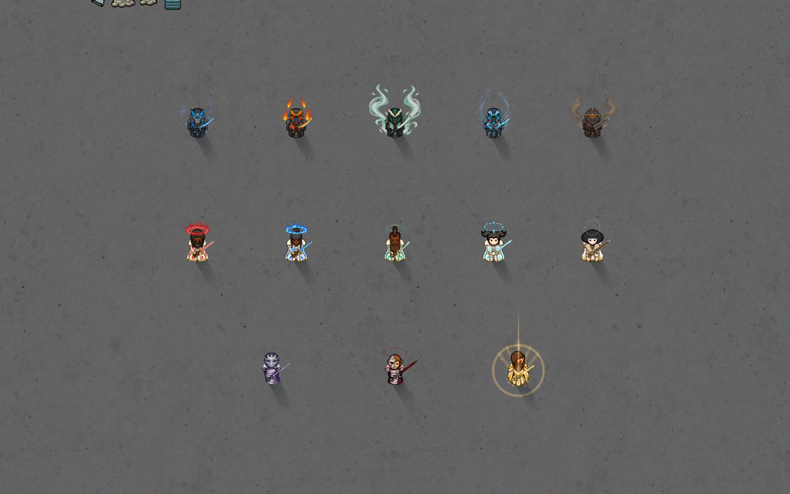
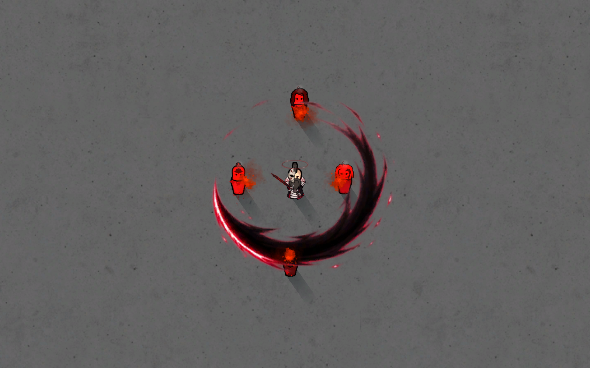
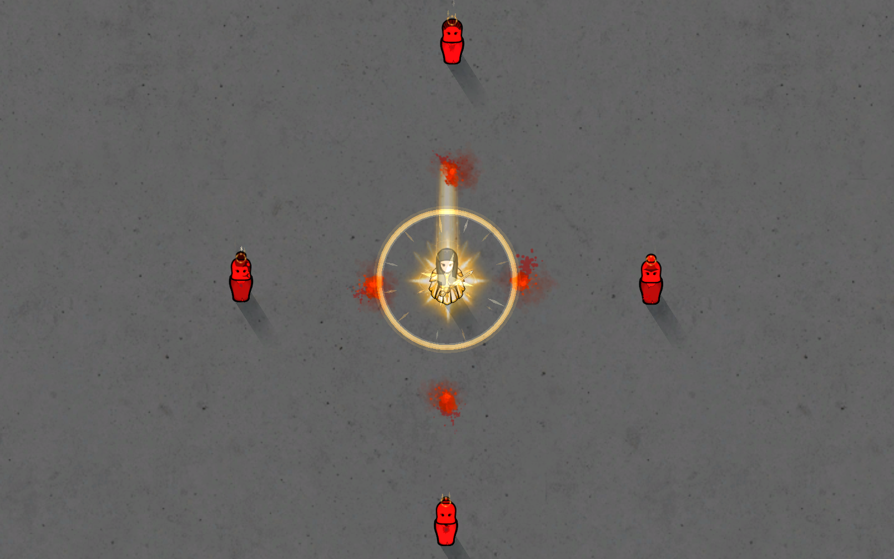
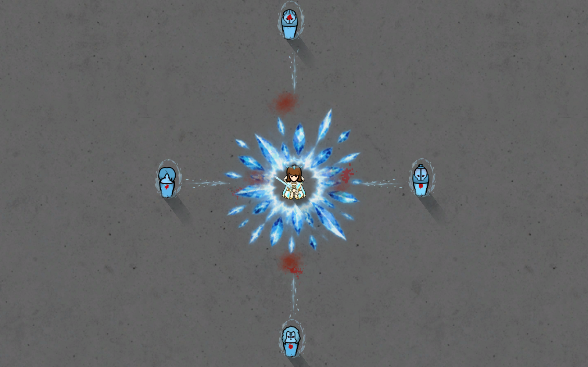

# Elemental Hearts

**Ascend. Teach. Evolve.** A sword-combat and progression mod for **RimWorld 1.6**.

Turn humanlike pawns into elemental warriors with permanent powers, bound swords, indestructible manifested armor and animated combat forms. Train disciples, earn an evolution, or receive a rare lineage from a Celestial. Fight manually or let Auto Combat chain techniques, counters and finishers.

This is an intentionally powerful, anime-inspired mod. Ordinary Ascendants exceed vanilla fighters; evolved lineages add stronger defenses and advanced techniques, while Celestial occupies the sovereign tier.



*Staged in-game roster. Top row, left to right: Lightning, Flame, Wind, Water, Earth. Middle: Thunderstorm, Azure Flame, Cyclone, Glacial, Adamant. Bottom: Lunar, Eclipse, Celestial. Screenshots use an isolated showcase save and the optional Melee Animation integration.*

## Download and installation

1. [Download the current mod as a ZIP](https://github.com/ZegionV2/ElementalHearts/archive/refs/heads/main.zip), or clone this repository.
2. Extract it into RimWorld's `Mods` folder. Rename `ElementalHearts-main` to `ElementalHearts` if needed.
3. Check the layout: `Mods/ElementalHearts/About/About.xml`. `Assemblies`, `Defs`, `Textures` and `Sounds` must sit directly inside `ElementalHearts`.
4. Enable **Harmony**, then **Elemental Hearts**, and restart RimWorld.

**Required:** RimWorld **1.6**, Core and [Harmony](https://steamcommunity.com/sharedfiles/filedetails/?id=2009463077). **No DLC required.** The compiled mod is included; players do not need to build it.

**Optional:** Melee Animation supplies its native sword animation system; Search and Destroy supports approach/combat behavior. Compatible sword profiles are included. Milira, VEF and Demon Summoning are not dependencies.

To update, close RimWorld and back up your save. Replace the mod with the complete new folder, keep only one enabled copy, and restart after replacing assemblies or textures.

## The complete playable roster

All forms below are implemented. Ordinary elements have four combat techniques, their evolutions five, Lunar five, and Eclipse/Celestial six. Transform, Teach/Bestow, automation and travel are additional commands.

| Normal lineage | Combat identity | Evolution | Evolved identity |
| --- | --- | --- | --- |
| **Lightning** | Sword cuts, electrical shocks, charges and counters | **Thunderstorm** | Crimson lightning, Scarlet Tempest spin and Tempest Dragon zigzag dash chains |
| **Flame** | Thermal sword forms, Cinder Step, Inferno Waltz and Phoenix Descent | **Azure Flame** | Blue fire, larger wheel attacks and Azure Reversal's retreat/counter-rush |
| **Wind** | Dust-Cutting Draw, Rising Gale, Turning Swallow and Mountain-Scouring Tempest; Flow rewards varied forms | **Cyclone** | Vacuum Draw, Skyward Gale, Cyclone Reversal, Heaven-Rending Tempest and Sovereign Cyclone |
| **Water** | Torrent Cleave, Flowing Step, Whirlpool Dance and Ocean's Judgement; Pressure and frontal parry/counter | **Glacial** | Glacial Crescent, Frostwake Step, Crystal Vortex, Absolute Zero and Glacial Explosion |
| **Earth** | Faultline Cleave, Stonebreaker Advance, Seismic Quake and Spire Eruption; Resolve supports impact and defense | **Adamant** | Adamant Severance, Mountain King's Advance, Sovereign Quake, Worldspine Eruption and Adamant Bulwark |
| **Lunar** | Five swift moonlit sword forms, Moonbrands and a pressure-triggered retreat/rush | **Eclipse** | Six black/crimson forms, Eclipse Brands, rear strikes and actual-eclipse empowerment |
| **Celestial** | Standalone sovereign: six solar/light forms, Radiance, Fake Rainbow and free Light Travel | — | Already fully evolved; no normal Celestial or Celestial disciple stage |

Normal kits have elemental armor, helmets and fitted swords. Evolved kits use white regal outfits, elemental accents and subtle halos; Eclipse adds a half-mask. Celestial has distinct ivory/gold regalia and a golden sword aura. Lunar wears broad silver shoulders, an indigo cloak and a crescent mask. Auras and halos appear only while **transformed and drafted**.

## Getting started

1. Acquire **Lightning, Flame, Wind, Water or Earth serum**, receive power through teaching/Bestow, or obtain a **Celestial Heart**. **Earth Serum and Celestial Heart** have drug-lab crafting recipes after **Fabrication**. Use an injection directly or administer it through a medical bill.
2. Ascension becomes a permanent whole-body condition. A pawn can have **one elemental lineage** at a time; this is not an extractable implanted organ.
3. Select **Transform** to manifest the kit, then draft the pawn. Choose skills manually or leave **Auto Combat: On** to combine attacks.
4. **Revert** restores personal equipment. Personal clothes are stored during manifestation; projected gear stays bound to its owner rather than becoming duplicate inventory items.

Bound Ascendant swords and armor are indestructible. They vanish on downing/death, restoring normal clothes; recovery or revival retains ownership. Player Ascendants can Transform again, while eligible NPCs manifest automatically. Disciples can call their swords without receiving the full armor/stat package.

## Disciples, ascension and evolution

| Path | Requirements and result |
| --- | --- |
| **Teach** | A normal Lightning/Flame/Wind/Water/Earth Ascendant teaches an eligible pawn. Both stop and face each other for a three-second animated lesson. The pupil becomes that element's disciple. |
| **Disciple → Ascendant** | **50 credited kills + five disciple days** unlock **Ascend**. A 3.5-second ceremony grants the normal lineage. Disciples use 40% technique damage and 50% longer base active cooldowns. |
| **Ascendant → evolution** | **150 additional unique hostile non-animal mastery kills + ten Ascendant days** unlock **Evolve**. A 4.5-second ceremony grants the evolved form, preserving relevant saved controls, cooldowns and personal gear. |
| **Evolved Bestow** | A four-second paired ceremony grants the matching normal lineage directly, skipping discipleship. Eclipse bestows Lunar. Ordinary evolution requirements still apply. |
| **Celestial Bestow** | **Lunar at 2%**, or **Lightning, Flame, Wind, Water or Earth at 19.6% each**. Never Celestial. Also fulfills future evolution milestones; **you still choose when to press Evolve**. |

Ceremonies are interruptible: incomplete rituals grant nothing and can be retried. Lunar does not Teach and is outside the ordinary serum and NPC disciple pools; acquire it through rare Celestial Bestow or Eclipse Bestow. Developer grant actions also supply lineages for sandbox play.

In **God Mode**, eligible disciples show **DEV: Ascend-Ready** and eligible unevolved Ascendants show **DEV: Evolution-Ready**. These fulfill milestones and unlock the ordinary action; they do not perform it. Turn God Mode off to hide them. Developer mode alone does not show readiness commands.

## Combat controls and damage

**Auto Combat** starts enabled when a pawn first becomes a disciple or Ascendant. Existing saved choices are retained. Player automation uses drafted, ready pawns and can be disabled globally in mod settings.

- **On:** automatically select techniques and follow combo opportunities.
- **Off:** use combat forms manually.
- **Non-lethal:** replace supported technique and ordinary melee injury with temporary suppression: usually a knockdown, otherwise a short stun. Existing wounds, other weapons and unrelated damage can still kill a pawn.

Moves have their own ranges, cooldowns and pressure/mark requirements. Dash routes check walls, occupied cells and landing space. Reversals respond to nearby pressure; finishers use the caster's own marks. Extra effect frames, afterimages and particles do not repeatedly trigger the same impact.

**The Melee damage stat is not a fixed ability-damage number.** Weapon quality, the current melee profile, technique coefficients, marks/charges and target defenses all matter. Eligible outgoing injury packets receive the mod's existing **20% damage reduction once**.

| Lineage | Lineage multiplier to Melee damage | Identical eligible physical packet after common tuning* |
| --- | --- | --- |
| Lightning, Flame, Wind, Water, Earth | ×2.00 (**+100%**) | ×1.60 |
| Azure Flame, Thunderstorm, Glacial, Cyclone | ×2.20 (**+120%**) | ×1.76 |
| Lunar | ×2.30 (**+130%**) | ×1.84 |
| Eclipse | ×2.65 (**+165%**) | ×2.12 |
| Adamant | ×2.80 (**+180%**) | ×2.24 |
| Celestial; Eclipse during a real eclipse | ×3.20 (**+220%**) | ×2.56 |

*Before armor, resistance, other pawn modifiers, technique coefficients and separate elemental packets. These compare otherwise identical physical packets with their unascended values; they are not final skill damage or DPS. A normal lineage turns a 20-damage physical packet into **20 × 2 × 0.8 = 32** before those other factors. Native melee profiles already include the melee stat; do not multiply it into them again.*

Eclipse gains **15% extra ability damage during an actual eclipse**, separately from its core stat upgrade. See the [damage guide](Docs/DamageGuide.md) for channels, disciples, armor and examples. This documentation update does not rebalance combat values.

## Rare and sovereign lineages

### Lunar and Eclipse

Lunar sits above ordinary Ascendants and below Celestial. **Crescent Draw** releases a ranged wave; **Moonfall Step** dashes into position; **Selene Dance** spins; **Falling Moon** spends Moonbrands in an area attack; **Moonbreak Rush** escapes pressure and rushes back.

Eclipse adds **Dusk Crescent, Umbral Pursuit, Crimson Waltz, Riven Horizon, Nightfall Reversal and Sovereign Eclipse**. Black slashes edged in crimson, checked rear/flank movement and caster-owned Brands support six-form combos.



*Crimson Waltz in staged combat. Each eligible enemy receives the form's bounded impact once.*

During a **real native eclipse**, Eclipse Dominion raises core combat stats to Celestial level and adds the ability bonus. Actively fighting with two visible enemies within five cells gives a **15% summon chance every ten seconds**. A summoned eclipse lasts **six in-game hours**, with a saved **one-day map/summoner cooldown**. It cannot stack or extend an existing eclipse. Natural eclipses grant the same boost. Because this is a real condition, the sky and solar generation are affected.

### Celestial

Celestial arrives fully evolved with **Dawncleaver, Sunstride, Corona Dance, Solar Judgment, Heavenly Zenith and Fake Rainbow**. Its baseline includes 650% movement, +75 mood, heavy defense and superior recovery. Radiance feeds finishers; **Fake Rainbow** parries into a rainbow mirage, retreat and light-trail counter-dash.

**Light Travel** is a manual, free world-map journey: choose a destination and safe landing cell, then depart/arrive through large solar beams. **Bestow (Random)** supplies the lineage chances and saved evolution readiness listed above.



*Heavenly Zenith uses layered light, shockwaves and particles around a bounded combat impact.*

### Crowd control and resistances

Lightning and Thunderstorm damaging electrical hits can stun standing hostiles: **25% for one second** and **40% for 1.5 seconds**, respectively, with three seconds of shock recovery. Flame/Azure resist heat, Water/Glacial extend cold tolerance, Earth/Adamant resist blunt impacts, and Wind/Cyclone disperse bomb damage. Lunar has reduced psychic sensitivity and cold tolerance; Celestial has solar/thermal defenses.



*Glacial Explosion answers two nearby enemies with a radial impact, checked outward knockback and a five-second icy-blue freeze. Lethal mode adds mild hypothermia; Non-lethal retains push/freeze without wounds or hypothermia.*

## Recovery, travel and NPCs

Benefits belong to the lineage rather than depending entirely on the projected outfit. Recovery repairs ordinary injuries and seals wounds; it does not regrow missing limbs or erase every permanent injury. Ascendants resist illness and food poisoning. Evolved lineages also reject **Melee Animation's specific `AM_KnockedOut` condition**, rather than gaining immunity to every stun/downing source.

Normal/Lunar, evolved and Celestial tiers receive **×5 / ×10 / ×15 carrying capacity**. Their individual walking-caravan speed contributions are **×2 / ×3 / ×4**, averaged with other eligible walking humanlike members. A mixed caravan does not receive the strongest member's full multiplier. Eclipse uses the sovereign tier while empowered by an actual eclipse.

New eligible adult humanlike NPCs from other factions have a **20% disciple spawn chance by default**, adjustable in mod settings. Only the five ordinary elements are in this pool. NPCs use automatic combat and summon appropriate bound gear.

Each eligible adult disciple, including NPCs, gets **one saved 5% near-death combat awakening roll**. Success grants normal ascension, immediately heals ordinary injuries, releases a shockwave and adds three seconds of heavy protection. Repeated hits do not keep rerolling the chance. Ordinary kill/time promotion remains available.

## Compatibility, saves and performance

- **Melee Animation:** optional native grip/blade profiles for bound swords; Lunar/Eclipse held swords have matching enlarged grips/trails.
- **Search and Destroy:** optional support for combat approach behavior.
- **Humanlike bodies:** seven fitted body textures, south/east/north and native west mirroring. Custom alien bodies or replacement pawn-rendering systems may need additional fitting.
- **Existing saves:** updates retain cooldowns, marks, readiness, gear ownership and technique progress through saved components. Removing the mod from a save containing its items/actions is not a supported uninstall path.
- **Effects:** cached materials, bounded pools, local searches and camera/fog culling. Frost/wind floor effects expire; techniques do not create permanent terrain, roofs, walls or uncontrolled projectile crowds. Eclipse is the deliberate native sky-condition exception.

For a disabled command, read its tooltip: transformation, a paired ritual, external animation control, cooldowns or a move's crowd/target requirements may block it. For problems, [open an issue](https://github.com/ZegionV2/ElementalHearts/issues) with the game/mod versions, load order, log and reproduction steps.

## Source and detailed guides

The playable mod includes `Assemblies/ElementalHearts.dll`. Source is in `Source`, definitions in `Defs`, artwork in `Textures` and audio in `Sounds`.

Build against your own installed game and Harmony assemblies:

```powershell
powershell -File .\Source\Build.ps1 -RimWorldDir "C:\Games\RimWorld"
```

Game and dependency assemblies are not redistributed. Repository `Tests` and `Tools` contain development checks/utilities. Isolated native test mods, saves and screenshot fixtures are excluded from the playable package.

- [Damage calculations and channels](Docs/DamageGuide.md)
- [Earth](Docs/EarthAscendant.md) · [Adamant](Docs/AdamantIntegration.md) · [Cyclone](Docs/CycloneIntegration.md)
- [Celestial mechanics and travel](Docs/CelestialAscendant.md) · [Eclipse mechanics](Docs/EclipseAscendant.md)
- [Teaching and ascension ceremonies](Docs/DiscipleCeremonies.md)
- [Lunar/Eclipse directional fitting](Docs/LunarEclipseFit.md)
- [Screenshot provenance](Docs/Images/README.md)

`Docs` preserves historical plans and validation reports. Some plans describe earlier designs; **this README's playable roster describes the current shipped mod**.
