# Elemental Hearts

**Ascend. Teach. Evolve.** A sword-combat and progression mod for **RimWorld 1.6**.

Turn humanlike pawns into elemental warriors with permanent powers, bound swords, indestructible manifested armor and animated combat forms. Train disciples, earn an evolution, or choose a lineage through a Celestial's Bestow. Fight manually or let Auto Combat chain techniques, counters and finishers.

This is an intentionally powerful, anime-inspired mod. Ordinary Adepts exceed vanilla fighters; evolved lineages add stronger defenses and advanced techniques, while Celestial, Thunder Incarnate, Hell Flame Incarnate, Tempest Incarnate and Aurora Incarnate occupy the sovereign tier. Eclipse matches their core combat tier during a real eclipse.

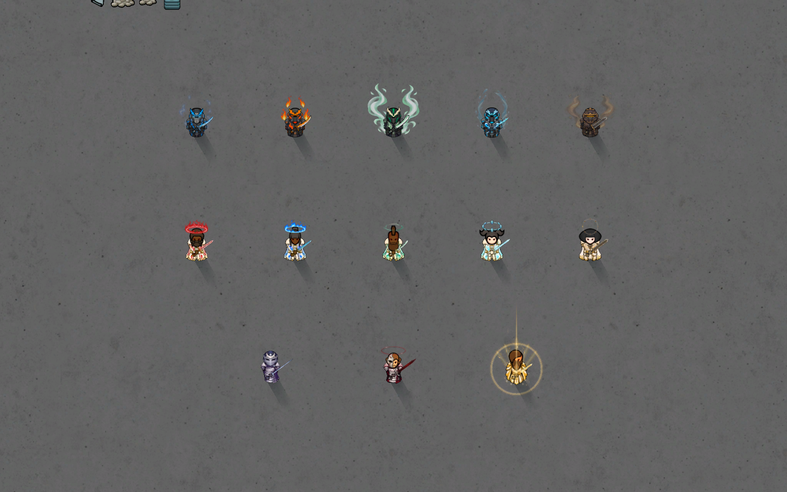

*Staged in-game roster of the original thirteen forms; Thunder Incarnate is shown below. Top row, left to right: Lightning, Flame, Wind, Water, Earth. Middle: Thunderstorm, Azure Flame, Cyclone, Glacial, Adamant. Bottom: Lunar, Eclipse, Celestial. Screenshots use an isolated showcase save and the optional Melee Animation integration.*

## Progression titles

**Disciple → Adept → Ascendant → Incarnate.** Normal Lightning, Flame, Water, Wind, Earth and Lunar forms are now **Adepts**. Azure Flame, Thunderstorm, Glacial, Cyclone, Adamant and Eclipse retain **Ascendant**. Celestial Ascendant remains a standalone sovereign; Incarnate names are unchanged.

For example: **Water Disciple → Water Adept → Glacial Ascendant → Aurora Incarnate**. Lunar is **Lunar Adept → Eclipse Ascendant**. The Ascend command and God Mode's DEV: Ascend-Ready still promote disciples to Adepts; Evolve promotes an Adept to an Ascendant. Requirements, stats and saved identities are unchanged.

The **Elemental Codex** groups the roster into Disciples, Adepts, Ascendants, Incarnates and Celestial, with a separate Otherworlder origin filter.

**Planned, not yet playable:** [Renown, witnessed stories and fear](Docs/RenownPlan.md). This proposes how pawns earn a reputation after reaching Ascendant or Incarnate and how other people react.

## Elemental Codex and squad controls

Open **Elementals** on the bottom toolbar to manage your disciples, all seventeen forms and recognized Otherworlders across maps and caravans. Search/filter the roster, inspect real kill/day progress, locate pawns and start their existing Ascend/Evolve ceremonies when eligible.

Select multiple rows for **Auto: On**, **Auto: Off**, **Non-lethal**, **Transform** or **Revert**. Group transformations use the normal animations and report pawns skipped because they are busy, incapacitated, off map or have queued orders. These controls occupy their own window, keeping individual skill menus readable. New summons retain their otherworld origin after Bestow; older summons are recognized when their school uniform and ISEKAI identity provide evidence. See [the Codex guide](Docs/AscendantCodex.md) for selection, safety and existing-save details.

## Cargo hauling, shared launch and impact audio


Selected passengers now gather without being counted as free cargo helpers. The carrier collects selected supplies when no eligible outside helper is available, including after saving mid-haul. A shared ivory/gold Launch icon serves all five sovereign travel lineages. The flying-pawn world marker is larger and has higher display priority, including older solo journeys. [Controls and sound sources](Docs/LivingFlightCargoAudio.md).

Glacial, Aurora, Tempest, Earth and Adamant have more distinct attack/impact sounds. Aurora and Tempest now use their own sound profiles. Suitable installed Vanilla Psycasts Expanded, Royalty and Anomaly clips are referenced at runtime; complete Core fallbacks remain. The shared spatial, camera/fog and voice budgets remain in place.

**Planned only:** [Garnet Incarnate, Adamant's third stage](Docs/GarnetIncarnatePlan.md): compressed crystal, seismic pressure, royal protection, seven forms and Fault Step/Garnet Travel.

## Wardrobe and living-flight overhaul

Thunder Incarnate has a newly drawn, slimmer east/west suit-and-cape profile. Fat/Hulk side bodies and clothing narrow together to prevent exposed skin; the front and back outfit designs are retained. Otherworlders receive newly drawn Japanese academy uniforms with low native necklines, tucked shoulders, flat chests and fitted side views. Boys keep the dark gakuran; girls keep the ivory/navy sailor uniform. Calling still generates only 18–24-year-old Male/Female/Thin humans with the established strong ISEKAI traits.

All five sovereign travel abilities prepare **visible living flights**. Choose an outdoor launch site first. The carrier stays manifested, companions gather there and available colonists haul supplies. With no suitable free hauler, the carrier gathers cargo themselves and returns to the site. Use the familiar people/items menu, select the carrier and press **Launch living flight** when ready. Capacity follows the carrier's enhanced caravan carrying capacity; no fuel, silver or cooldown. Arrive as a caravan, visit a settlement, attack from the center/edge, or choose a safe outdoor landing cell. ISEKAI Tower trips retain the Tower's native floor-entry choices. Incarnate Step keeps its map blink and three-state utility cycle. [Group travel guide](Docs/GroupTravel.md).

The earlier [Anomaly-inspired travel proposal](Docs/AnomalyTravelEffectsPlan.md) is shelved. That visual inspiration is reserved for a future new element.

Water's third stage, **Aurora Incarnate**, is playable: seven winter forms combine rapid chain-dash cuts, northern-light curtains, frost, snow, Mirrorfrost counters and a grand crystalline crown collapse. Glacial mastery requires 300 new hostile kills and 15 days, followed by a free frost coronation. It preserves Water's Pressure and defense controls, gains sovereign power, fitted winter-prince regalia/Winterglass, halo/back aura, Bestow: Water and Rime Step/Aurora group travel. [Full mechanics and save rules](Docs/AuroraIncarnate.md).

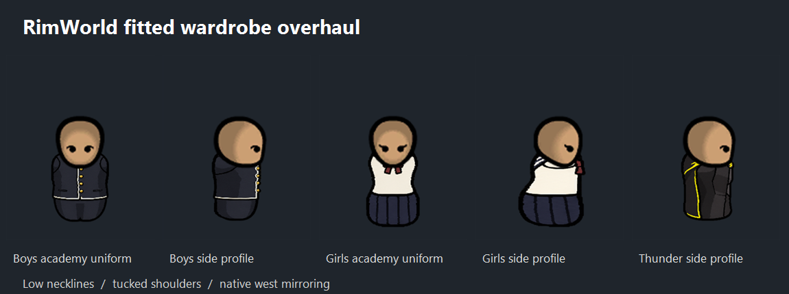

## Tempest Incarnate

**Wind → Cyclone → Tempest Incarnate.** Earn **300 new credited hostile non-animal kills and 15 days as Cyclone**, then use the free, interruptible **eight-second Transcend** ceremony. Existing Cyclones begin their separate third-stage mastery when this update loads, including world/caravan pawns. The Codex tracks readiness. **God Mode** exposes **DEV: Transcend-Ready**, which unlocks the ordinary ceremony and hides immediately when God Mode turns off.

Seven cloud-and-white-lightning forms replace the previous Wind/Cyclone skills. Shared **Auto / Off / Non-lethal** controls remain intact. They include a twenty-cell pressure crescent, checked pursuit dash, eight-cell spin, guarded cloud-mirage counter, three-cut rising/descending Squall, bounded Maelstrom airhold/release and **Crown of the Tempest**, a warned ten-cell storm impact. Larger attacks remain available against a lone sovereign opponent. Different committed forms build **Storm Flow**; a full-charge finisher consumes it for 20% stronger strikes and two seconds of extra protection.

Core stats match the sovereign tier: **Moving 650%, Consciousness 200%, Manipulation 300%, Sight/Hearing 250%, +75 mood, ×3.2 melee stat, 0.04 incoming damage**, rapid recovery, ×15 carrying capacity and ×4 individual caravan-speed contribution. Tempest disperses 65% of remaining bomb damage and reduces electrical-shock chance/duration by 75%. Bestow grants ordinary Wind.

The indestructible **Skyrend katana** and dark tailored suit/cape use fitted native body textures and a native Melee Animation profile. The suit covers actual body parts below the neck. Its subtle cloud halo and back aura appear while transformed and drafted. **Cloud Step / Tempest Travel** shares one button: right-click cycles **Auto → Manual → Travel**. Shift-left-click Step selects any safe map cell; Travel opens a party-and-cargo transport loader. No resource costs or world-travel cooldown. [Full mechanics and save rules](Docs/TempestIncarnate.md).

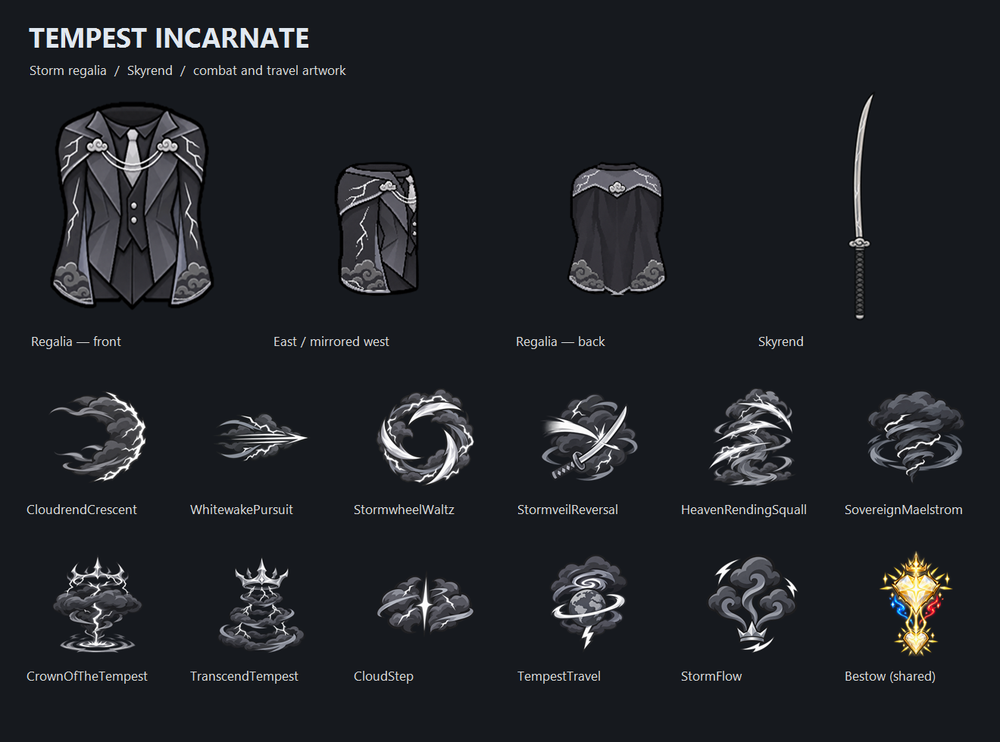

## Hell Flame Incarnate

**Flame → Azure Flame → Hell Flame Incarnate.** Earn **300 new credited hostile non-animal kills and 15 days as Azure Flame**, then press **Transcend** for a free eight-second infernal coronation. Separate saved third-stage counters begin when existing Azure Flames load this update. God Mode exposes **DEV: Transcend-Ready**, which unlocks the ordinary ceremony.

Seven forms combine aimed hellfire crescents, fast katana pursuit, an eight-cell spin, a Phoenix finisher, a reactive retreat/rush against two nearby foes, a ground-stab furnace shockwave and **Sovereign's Pyre**, a warned ten-cell eruption. Opening strikes build up to three **caster-owned Hellbrands**; Phoenix and Pyre consume them to strengthen the same committed impact. Shared Auto Combat and Non-lethal apply. Auto Combat uses the larger offensive forms against a lone evolved rival or a sufficiently branded target, while Reversal retains its two-enemy trigger. A bounded dodge counter and sovereign-scale Phoenix/Furnace strikes support duels as well as crowd combat. **Infernal Resolve** reduces electrical-shock chance/duration by 75%; consuming three Hellbrands empowers the finisher by 20% and grants a two-second protective ward. Incarnates keep chaining after returning to drafted waiting while respecting distinct queued player orders. The black tailored suit/crimson-lined cape has full mechanical below-neck coverage, with an ivory **Ashreign katana**, hollow infernal crown and subtle animated back aura.

Core power matches Celestial/Thunder Incarnate: **Moving 650%, Consciousness 200%, Manipulation 300%, Sight/Hearing 250%, +75 mood, ×3.2 melee damage and 0.04 incoming damage**, with rapid recovery and fire/heatstroke immunity. **Hell Step / Hell Travel** shares one button: right-click cycles **Auto → Manual → Travel**; Shift + left-click Step chooses any safe map cell, while Travel flies to a chosen world tile and offers exact landing on arrival. No resource costs. Bestow grants ordinary Flame. [Full mechanics, cooldowns and save rules](Docs/HellFlameIncarnate.md).

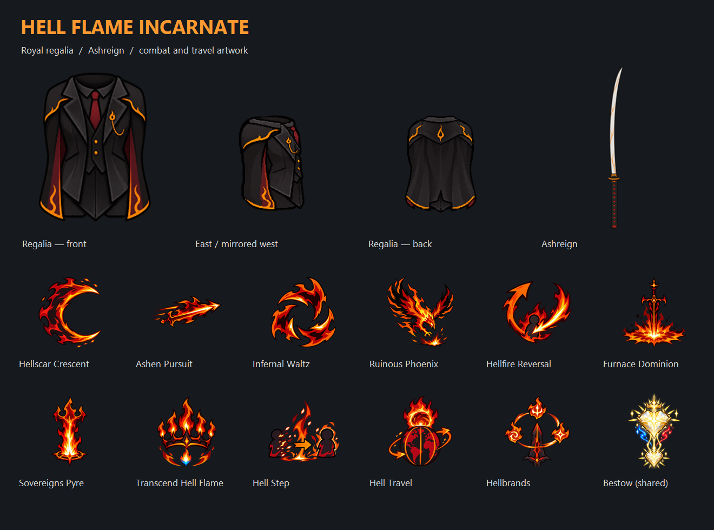

*Asset overview; the form is implemented. This image is artwork, not an in-game combat capture.*

## Thunder Incarnate

**Lightning → Thunderstorm → Thunder Incarnate.** Earn **300 new credited hostile non-animal kills and 15 days as Thunderstorm**, then begin the free eight-second **Transcend** ceremony. This is a separate third-stage mastery counter; existing Thunderstorms start it when the update loads. The Elemental Codex tracks readiness, and **God Mode** exposes **DEV: Transcend-Ready** to unlock the normal ceremony.

Thunder Incarnate matches Celestial's core damage, defense and recovery. Healthy native capacities show **Moving 650%, Consciousness 200%, Manipulation 300%, Sight/Hearing 250%**, with **+75 mood**. Its black princely suit, compact modern cloak, white-bladed Heavenbreaker katana, storm crown and animated lightning back aura give it a distinct black/yellow silhouette.

| Combat form | Behavior | Base cooldown |
| --- | --- | --- |
| **Divine Severance** | Broad ranged sword crescent through a clear lane; applies Charged. | 3 s |
| **Thunderstep Strike** | Checked dash to an adjacent landing and a focused katana strike. | 3.5 s |
| **Blackbolt Waltz** | Eight-cell spinning storm that consumes caster-owned charges. | 6 s |
| **Skybreaker Judgment** | Fast approach, visible warning, heavy contact strike and five-cell corona. | 13 s |
| **Heaven-Rending Dragon** | Up to ten distinct enemies connected by straight zigzag dash legs. | 15 s |
| **Heavenfall Verdict** | Aerial rush into an eight-cell landing shockwave. | 22 s |
| **Sovereign Thunderfall** | A colossal lightning-filled pillar and ten-cell AOE, capped at 32 eligible hostiles. | 40 s |

Changing committed forms builds **Storm Dominion**. A fully charged Judgment, Verdict or Thunderfall gains **20% ability damage** and a short extra defensive ward. Shared **Auto Combat / Off / Non-lethal** controls apply; cooldowns are spent on a valid start, including interrupted casts. Saved impact rules prevent animation frames from repeating hits. [Full mechanics and save compatibility](Docs/ThunderIncarnate.md).

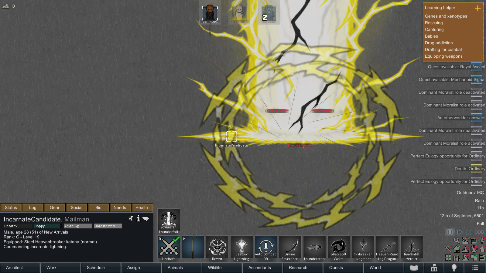

*Native in-game capture at peak discharge. Staged opponents allow the animation to be shown; this is not a damage benchmark.*

### Thunder Step and Thunder Travel

One shared utility button keeps the skill menu compact. **Right-click cycles Step: Auto → Step: Manual → Travel → Step: Auto.** Manual and Travel both turn automatic map stepping **off**.

| Button mode | Left-click | Shift + left-click |
| --- | --- | --- |
| **Step: Auto** | Turn automatic stepping off. | Choose a manual map-wide blink. |
| **Step: Manual** | Turn automatic stepping on. | Choose a manual map-wide blink. |
| **Travel** | Choose another settlement or land tile, fly there, then choose an unroofed landing cell on arrival. | Fly with automatic safe landing on arrival. |

Map stepping ignores sight, fog and range, costs no resources and has a **one-second recharge**. Its destination must be empty and walkable. Auto Step defaults on independently of Auto Combat and follows work/movement routes while retaining current jobs, queued orders and carried items or passengers. Put down carried things before world travel; Thunder Travel has **no fuel cost, distance charge or cooldown**.

World travel keeps the familiar loading menu and native destination choices. The original carrier and companions remain visible while gathering, then rise and descend through the carrier's elemental travel effects and a shared sixteen-frame launch vortex. The moving world marker is a flying pawn, and destination menus keep the world map visible. No physical transport pod or pod drop animation appears. People, animals and cargo travel together. Canceling a chosen-cell landing keeps the party in a caravan; the saved **Choose landing cell** command resumes it. Caravans with a qualified carrier can fly onward. Existing solo flights remain supported. [Full group-flight guide](Docs/GroupTravel.md).

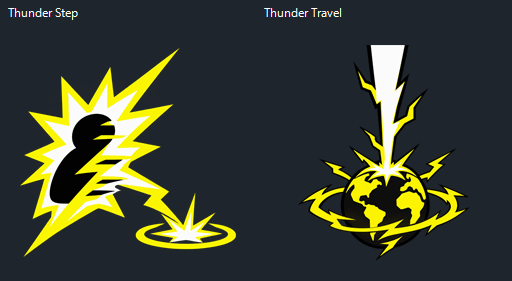

*Command-art preview. Step blink and ordinary melee clashes each have eight animation frames; the subtle back crest has six. Cached materials, bounded pools and camera/fog culling also cover these effects.*

Hell Flame and Tempest held katanas have wider blades and a slightly larger silhouette, including their native Melee Animation profiles. The katana's cutting edge is fitted in both native held rendering and optional Melee Animation, retaining its tip direction and hand anchor. Side-view head/hair alignment is adjusted across the supported body textures; Fat/Hulk cloaks retain their slimmer fit. The crown and back aura appear while transformed, drafted, standing and awake.

Lethal techniques can **blast nearby scenery and leave ash and native fires**. These are bounded committed effects, separate from the technique's saved pawn impacts. **Non-lethal** disables scenery explosions and ignition; **Mod settings → Thunder Incarnate scenery damage and fires** can disable them entirely. Native fires follow RimWorld's normal behavior. Ordinary melee lightning is visual only and does not add extra hits or structural blasts.

## Otherworld Calling

Celestials can call one permanent human colonist for **1,000 silver**. Choose a safe cell and complete a three-second solar doorway ceremony. Recruits are **18–24**, with Male/Female/Thin bodies only: men wear the fitted boys' gakuran, women the fitted schoolgirl sailor uniform. No Fat or Hulk recruits.

With **ISEKAI RPG LEVELING** enabled, every traveler brings one powerful identity (Summoned Hero, Protagonist or Regressor) and two compatible talents. They receive elemental powers separately through **Bestow**. Missing ISEKAI support disables this command without affecting the rest of the mod. One in-game hour cooldown by default; change it to 0–24 in-game hours in mod settings.

Silver is reserved from reachable, visible, allowed silver anywhere on the current map, including loose stacks outside storage/home areas, returned for pre-commit interruption and consumed once for a committed arrival. Saving/loading retains the same person, traits, money and cooldown. A saved recovery letter handles blocked paid arrivals. Existing one-day cooldowns migrate using the original cast time. Celestial Bestow now uses colored lineage cards, evolution previews and separate mastery/readiness choices. See [the full Calling guide](Docs/OtherworldCalling.md).

## Download and installation

1. [Download the current mod as a ZIP](https://github.com/ZegionV2/ElementalHearts/archive/refs/heads/main.zip), or clone this repository.
2. Extract it into RimWorld's `Mods` folder. Rename `ElementalHearts-main` to `ElementalHearts` if needed.
3. Check the layout: `Mods/ElementalHearts/About/About.xml`. `Assemblies`, `Defs`, `Textures` and `Sounds` must sit directly inside `ElementalHearts`.
4. Enable **Harmony**, then **Elemental Hearts**, and restart RimWorld.

**Required:** RimWorld **1.6**, Core and [Harmony](https://steamcommunity.com/sharedfiles/filedetails/?id=2009463077). **No DLC required.** The compiled mod is included; players do not need to build it.

**Optional:** Melee Animation supplies its native sword animation system; Search and Destroy supports approach/combat behavior. Compatible sword profiles are included. Milira, VEF and Demon Summoning are not dependencies.

To update, close RimWorld and back up your save. Replace the mod with the complete new folder, keep only one enabled copy, and restart after replacing assemblies or textures.

## Enemy faction: The Severed Court

An authoritarian order of elemental sword warriors with shared obsidian/ivory armor, crimson cloaks and a broken-crown insignia. **The Court fields Oathling disciples, normal Court Knights and five evolved Heralds** across Flame, Lightning, Water, Wind and Earth. Their Severed Oath trait changes transformed apparel while preserving elemental powers, armor stats and bound swords. Recruited members renounce the oath as redemption and regain normal elemental apparel, keeping their powers and bound sword. Already-recruited pawns are corrected when loading older saves.

Azure, Storm, Frost, Gale and Adamant Heralds wear shared elite obsidian/ivory regalia, crimson cloaks and open-brow faceguards. Each keeps the appropriate evolved sword, five techniques, stats and combat halo. Ten native Court backstories give the new ranks and deserters their own histories.

Element icons appear beside native map names and update on awakening/evolution. Ordinary walking raids begin from day 30. From day 60 and 8,000 points, smaller eligible raids can roll one Herald; **10,000-point or larger Court combat raids guarantee one Herald**, provided Heralds are enabled and a surviving, unengaged base can dispatch one. All squads remain capped at sixteen and within their actual points budget. Clearing Court bases stops their Herald dispatches.

**Every Court settlement uses the detailed fortress generator**, including the native first settlement and ordinary bases placed during world generation. Each fresh base starts with one Herald, two Knights and six Oathlings. Send a caravan and choose Attack to enter its command hall, barracks, infirmary, armory and finite treasury. Existing native world-object IDs, quest references and other factions are preserved. Visited maps retain their current buildings until regenerated and keep their surviving defenders; troops and taken loot are not replenished.

When loading an older save, a **Court settlement setup menu** appears once before adding bases. Choose a saved total, including zero when no Court is present. Five is recommended; larger totals repeat the five elemental commanders. Existing and cleared bases count toward that total. **Mod settings → Elemental Hearts → Configure Court settlements in this world** reopens the menu to increase it. New worlds with the Court enabled use five bases by default, retaining any larger native-generated count. Repeated loading never adds replacements or recreates a defeated faction.

Court stories include Herald's Writ, Broken Oath sanctuary offers, dedicated Herald assaults, Stronghold Dossiers and two new encounters: **The Severed Crucible** offers serum materials with an explicit one-day recovery pursuit; **The Herald's Ultimatum** lets you pay a tribute to recall one announced Herald expedition or defy it and prepare for its two-day arrival. Choices, cooldowns, origins and pending attacks persist through saving/loading. Lunar/Eclipse Court bosses remain planned. [Roster, settings and integration details](Docs/SeveredCourt.md).

Hostile Court deaths leave matching **elemental essence**: Oathlings drop 1–2, Knights 3–4 and Heralds 6–8 plus a **Herald crucible sigil**. At a drug lab after Fabrication, eight matching essence, two industrial medicine and one industrial component make that element's serum. A sigil refines into four essences of your chosen ordinary element. Loot claims persist through resurrection and saves; redeemed colonists are excluded. [Loot, recipes and campaign changes](Docs/CourtEnemyUpdate.md).

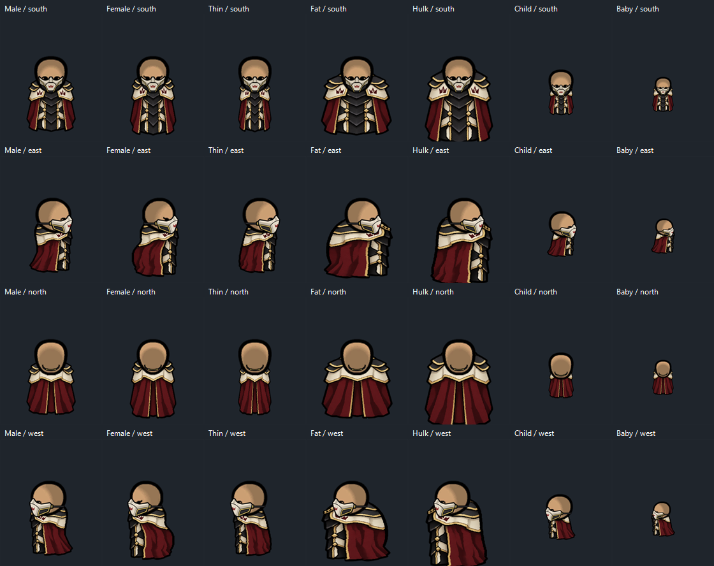

*Herald asset fit preview: south/east/north and native mirrored west, across all seven body textures.*

The Herald side faceguard now sits over the mouth and chin, with a thin rear strap and an open brow. Strongholds feature a double-depth gate, four corner watch posts, two gatehouses, lineage-colored ceremonial paths and a furnished command dais. Court standards, warm braziers, barracks furniture, a medical ward, an armory and a treasury vestibule give the forts a shared command-center identity.

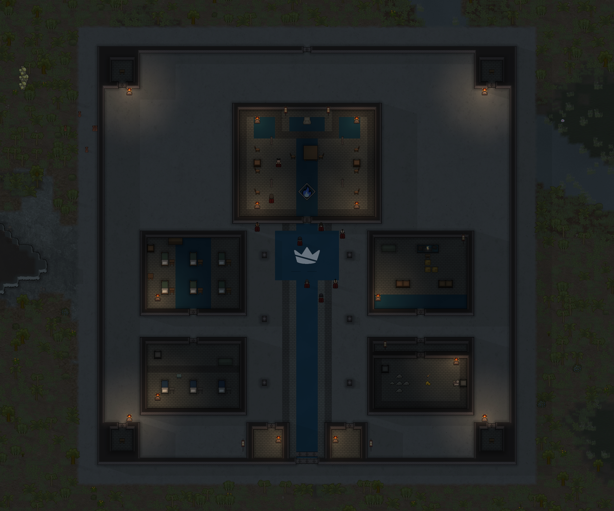

*New or regenerated stronghold maps use the full 59×59 layout. Already-loaded forts receive an additive interior upgrade on loading; their existing perimeter, defenders, provisions and player construction are preserved. [Faceguard, architecture and verification details](Docs/CourtDetail.md).*


## The complete playable roster

All forms below are implemented. Ordinary elements have four combat techniques, their evolutions five, Lunar five, Eclipse/Celestial six, and Thunder/Hell Flame/Tempest/Aurora Incarnate seven. Transform, Teach/Bestow, automation and travel are additional commands.

| Normal lineage | Combat identity | Evolution | Evolved identity |
| --- | --- | --- | --- |
| **Lightning** | Sword cuts, electrical shocks, charges and counters | **Thunderstorm → Thunder Incarnate** | Crimson zigzag chains evolve into seven grand black/yellow forms, Celestial-tier core strength, Storm Dominion and Sovereign Thunderfall |
| **Flame** | Thermal sword forms, Cinder Step, Inferno Waltz and Phoenix Descent | **Azure Flame → Hell Flame Incarnate** | Blue fire and Reversal evolve into seven black/crimson hellfire forms, Celestial-tier core strength, Hellbrands and Sovereign's Pyre |
| **Wind** | Dust-Cutting Draw, Rising Gale, Turning Swallow and Mountain-Scouring Tempest; Flow rewards varied forms | **Cyclone → Tempest Incarnate** | Cyclone's five forms become seven dark-cloud/white-lightning forms, Storm Flow and Crown of the Tempest |
| **Water** | Torrent Cleave, Flowing Step, Whirlpool Dance and Ocean's Judgement; Pressure and frontal parry/counter | **Glacial → Aurora Incarnate** | Glacial's five forms become seven northern-light/frost forms, chain Blitz, Mirrorfrost and Throne of Endless Winter |
| **Earth** | Faultline Cleave, Stonebreaker Advance, Seismic Quake and Spire Eruption; Resolve supports impact and defense | **Adamant** | Adamant Severance, Mountain King's Advance, Sovereign Quake, Worldspine Eruption and Adamant Bulwark |
| **Lunar** | Five swift moonlit sword forms, Moonbrands and a pressure-triggered retreat/rush | **Eclipse** | Six black/crimson forms, Eclipse Brands, rear strikes and actual-eclipse empowerment |
| **Celestial** | Standalone sovereign: six solar/light forms, Radiance, Fake Rainbow and free Light Travel | — | Already fully evolved; no normal Celestial or Celestial disciple stage |

Adept kits have elemental armor, helmets and fitted swords. Ascendant kits use white regal outfits, elemental accents and subtle halos; Eclipse adds a half-mask. Celestial has distinct ivory/gold regalia and a golden sword aura. Lunar wears broad silver shoulders, an indigo cloak and a crescent mask. Player auras and halos appear only while **transformed and drafted**. Enemy Court Heralds display their elemental halos during active combat while transformed.

Azure Flame has dedicated eight-frame blue-fire crescents, comet trails, a rotating pyre, a phoenix warning/eruption and Reversal afterimages. Earth's personal aura is six floating rocks orbiting in front of and behind the pawn. Adamant wears a shaded open circlet; Eclipse's ranged waves face their travel direction. These visual effects retain the existing combat and save rules. See [visual effect details](Docs/VisualEffects.md).

## Celestial travel, Bestow and Court combat

**Light Travel** opens the party-and-cargo menu. The Celestial remains visible, companions gather beside them and colonists haul supplies; select the Celestial to launch once ready, then choose a native arrival action. Settlement visit/attack menus and ISEKAI Tower floor entry are preserved. No fuel, silver or cooldown. [Controls and save compatibility](Docs/GroupTravel.md).

**Celestial Bestow** opens one configuration window: select the ordinary element or Lunar, choose evolution readiness, then select the recipient. The paired four-second ceremony keeps both pawns facing each other. Enemy and prisoner recipients keep their faction/status. A pawn with an existing elemental lineage cannot receive a second one. Existing saved ceremonies retain their already-selected result.

**Court battle tactics** add stronger training, active melee pursuit, pressure on armed/elemental opponents and limited leader-focus support. Four nearby hostile Court warriors form a temporary defense/movement formation; breaking the group removes it. They stand their ground. Settings can disable tactics/formations, and recruitment immediately removes the enemy formation benefit. Custom body types such as FemaleBB use a complete fitted Court uniform in every direction.

[Mechanics and verification](Docs/SolarCourtUpdate.md). **Otherworld Calling is now available**: spend 1,000 silver to recruit an adult otherworlder with a matching academy uniform and strong ISEKAI traits, then choose their elemental power through Bestow. [Calling guide](Docs/OtherworldCalling.md).

## Getting started

1. Acquire **Lightning, Flame, Wind, Water or Earth serum**, receive power through teaching/Bestow, or obtain a **Celestial Heart**. **Earth Serum and Celestial Heart** have drug-lab crafting recipes after **Fabrication**. Use an injection directly or administer it through a medical bill.
2. Ascension becomes a permanent whole-body condition. A pawn can have **one elemental lineage** at a time; this is not an extractable implanted organ.
3. Select **Transform** to manifest the kit, then draft the pawn. Choose skills manually or leave **Auto Combat: On** to combine attacks.
4. **Revert** restores personal equipment. Personal clothes are stored during manifestation; projected gear stays bound to its owner rather than becoming duplicate inventory items.

Bound elemental swords and armor are indestructible. They vanish on downing/death, restoring normal clothes; recovery or revival retains ownership. Player elemental wielders can Transform again, while eligible NPCs manifest automatically. Disciples can call their swords without receiving the full armor/stat package.

## Disciples, ascension and evolution

| Path | Requirements and result |
| --- | --- |
| **Teach** | A normal Lightning/Flame/Wind/Water/Earth Adept teaches an eligible pawn. Both stop and face each other for a three-second animated lesson. The pupil becomes that element's disciple. |
| **Disciple → Adept** | **50 credited kills + five disciple days** unlock **Ascend**. A 3.5-second ceremony grants the normal lineage. Disciples use 40% technique damage and 50% longer base active cooldowns. |
| **Adept → Ascendant** | **150 additional unique hostile non-animal mastery kills + ten Adept days** unlock **Evolve**. A 4.5-second ceremony grants the evolved form, preserving relevant saved controls, cooldowns and personal gear. |
| **Evolved Bestow** | A four-second paired ceremony grants the matching normal lineage directly, skipping discipleship. Eclipse bestows Lunar. Ordinary evolution requirements still apply. |
| **Celestial Bestow** | Open the Bestow menu, choose **Flame, Lightning, Water, Wind, Earth or Lunar**, and toggle **Ready to evolve immediately**. Then target a conscious humanlike pawn, including prisoners or enemies. Faction allegiance is retained. Never grants Celestial. **Evolve remains a separate choice**; with readiness off, the recipient earns the normal milestones. |

Ceremonies are interruptible: incomplete rituals grant nothing and can be retried. Lunar does not Teach and is outside the ordinary serum and NPC disciple pools; acquire it through chosen Celestial Bestow or Eclipse Bestow. Developer grant actions also supply lineages for sandbox play.

In **God Mode**, eligible disciples show **DEV: Ascend-Ready** and eligible unevolved Adepts show **DEV: Evolution-Ready**. These fulfill milestones and unlock the ordinary action; they do not perform it. Turn God Mode off to hide them. Developer mode alone does not show readiness commands.

## Combat controls and damage

**Auto Combat** starts enabled when a pawn first becomes a disciple or Adept. Existing saved choices are retained. Player automation uses drafted, ready pawns and can be disabled globally in mod settings.

- **On:** automatically select techniques and follow combo opportunities.
- **Off:** use combat forms manually.
- **Non-lethal:** replace supported technique and ordinary melee injury with temporary suppression: usually a knockdown, otherwise a short stun. Existing wounds, other weapons and unrelated damage can still kill a pawn.

Moves have their own ranges, cooldowns and pressure/mark requirements. Dash routes check walls, occupied cells and landing space. Reversals respond to nearby pressure; finishers use the caster's own marks. Extra effect frames, afterimages and particles do not repeatedly trigger the same impact.

**The Melee damage stat is not a fixed ability-damage number.** Weapon quality, the current melee profile, technique coefficients, marks/charges and target defenses all matter. Eligible outgoing injury packets receive the mod's existing **20% damage reduction once**.

| Lineage | Lineage multiplier to Melee damage | Identical eligible physical packet after common tuning* |
| --- | --- | --- |
| Lightning, Flame, Wind, Water, Earth | ×2.00 (**+100%**) | ×1.60 |
| Azure Flame, Thunderstorm, Glacial, Cyclone, Adamant | ×2.20 (**+120%**) | ×1.76 |
| Lunar | ×2.30 (**+130%**) | ×1.84 |
| Eclipse | ×2.65 (**+165%**) | ×2.12 |
| Thunder, Hell Flame, Tempest and Aurora Incarnate | ×3.2 (**+220%**) | ×2.56 |
| Celestial; Eclipse during a real eclipse | ×3.20 (**+220%**) | ×2.56 |

*Before armor, resistance, other pawn modifiers, technique coefficients and separate elemental packets. These compare otherwise identical physical packets with their unascended values; they are not final skill damage or DPS. A normal lineage turns a 20-damage physical packet into **20 × 2 × 0.8 = 32** before those other factors. Native melee profiles already include the melee stat; do not multiply it into them again.*

Eclipse gains **15% extra ability damage during an actual eclipse**, separately from its core stat upgrade. See the [damage guide](Docs/DamageGuide.md) for channels, disciples, armor and examples. Adamant uses the standard evolved combat tier; Eclipse and Celestial retain their higher tier.

## Allied synchronization

Enabled by default in mod settings. When two allied transformed elemental wielders strike the same enemy within **four seconds** while within **eight clear cells**, both gain **10% melee damage and movement for four seconds**. Celestial or an eclipse-empowered Eclipse grants a stronger **15%** version. Each participant has one shared **six-second cooldown**; additional allies do not stack copies or bypass it.

| Elemental pairing | Support |
| --- | --- |
| **Flame + Wind** | Strengthen one existing hit by 15%; no extra damage packet. |
| **Water + Lightning** | A brief, electrically resisted discharge; existing shock recovery blocks repeated stun. |
| **Water with any ally** | Repair up to four ordinary injury points on each participant, once. |
| **Earth with any ally** | Share a four-second ward reducing remaining incoming damage by 15%. |

Evolutions inherit their elemental family. Lunar and Eclipse join the shared coordination bonus; sovereign lineages improve its strength. Supported manual/automatic forms, Returning Tide and non-lethal Glacial control can participate. Brief connecting ribbons and ground rings show the link; there are **no additional skill-menu buttons**. [Full synchronization rules](Docs/AlliedSynchronization.md).

## Rare and sovereign lineages

### Lunar and Eclipse

Lunar sits above ordinary Adepts and below Celestial. **Crescent Draw** releases a ranged wave; **Moonfall Step** dashes into position; **Selene Dance** spins; **Falling Moon** spends Moonbrands in an area attack; **Moonbreak Rush** escapes pressure and rushes back.

Eclipse adds **Dusk Crescent, Umbral Pursuit, Crimson Waltz, Riven Horizon, Nightfall Reversal and Sovereign Eclipse**. Black slashes edged in crimson, checked rear/flank movement and caster-owned Brands support six-form combos.

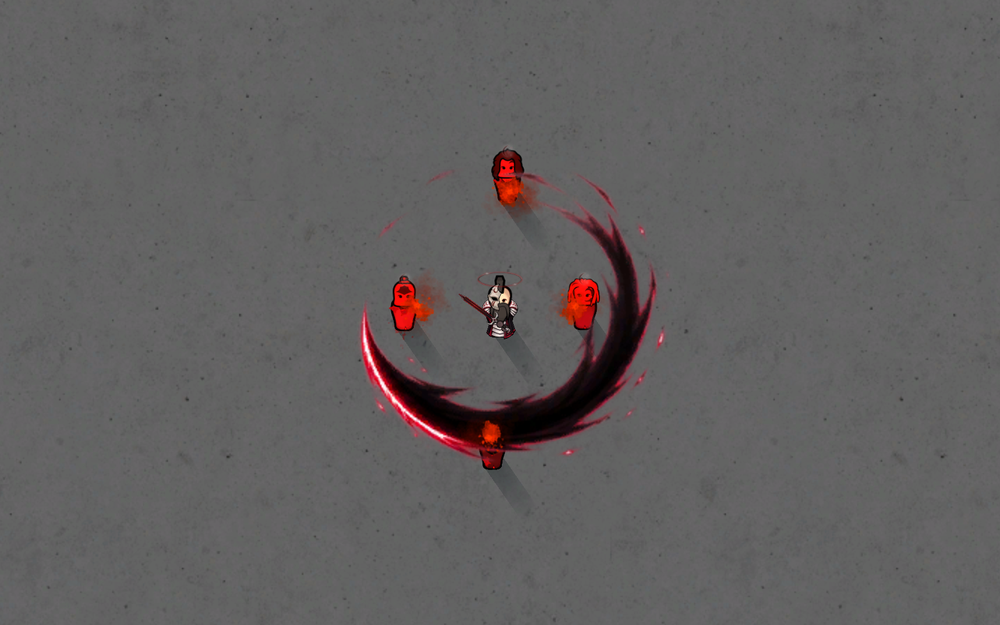

*Crimson Waltz in staged combat. Each eligible enemy receives the form's bounded impact once.*

During a **real native eclipse**, Eclipse Dominion raises core combat stats to Celestial level and adds the ability bonus. Actively fighting with two visible enemies within five cells gives a **15% summon chance every ten seconds**. A summoned eclipse lasts **six in-game hours**, with a saved **one-day map/summoner cooldown**. It cannot stack or extend an existing eclipse. Natural eclipses grant the same boost. Because this is a real condition, the sky and solar generation are affected.

### Celestial

Celestial arrives fully evolved with **Dawncleaver, Sunstride, Corona Dance, Solar Judgment, Heavenly Zenith and Fake Rainbow**. Its baseline includes 650% movement, +75 mood, heavy defense and superior recovery. Radiance feeds finishers; **Fake Rainbow** parries into a rainbow mirage, retreat and light-trail counter-dash.

**Light Travel** gathers passengers and cargo around the visible Celestial, with elemental departure/arrival effects, native settlement arrival choices and Tower floor entry. **Bestow** opens the element/readiness menu described above. Both remain manual and free.

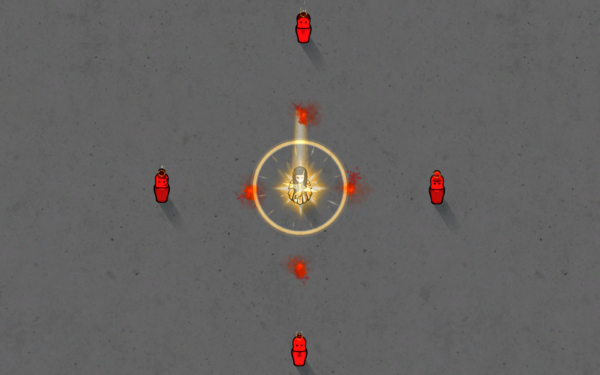

*Heavenly Zenith uses layered light, shockwaves and particles around a bounded combat impact.*

### Crowd control and resistances

Lightning, Thunderstorm and Thunder Incarnate damaging electrical hits can stun standing hostiles: **25% for one second**, **40% for 1.5 seconds** and **45% for 1.5 seconds**, respectively, with three seconds of shock recovery. Flame/Azure resist heat, Hell Flame Incarnate is immune to fire and heatstroke, Water/Glacial extend cold tolerance, Earth/Adamant resist blunt impacts, and Wind/Cyclone/Tempest disperse bomb damage. Lunar has reduced psychic sensitivity and cold tolerance; Celestial has solar/thermal defenses.

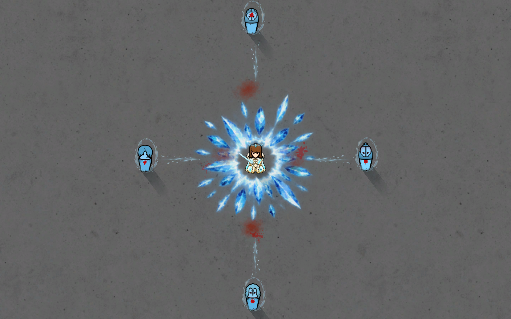

*Glacial Explosion answers two nearby enemies with a radial impact, checked outward knockback and a five-second icy-blue freeze. Lethal mode adds mild hypothermia; Non-lethal retains push/freeze without wounds or hypothermia.*

## Recovery, travel and NPCs

Benefits belong to the lineage rather than depending entirely on the projected outfit. Recovery repairs ordinary injuries and seals wounds; it does not regrow missing limbs or erase every permanent injury. Elemental wielders resist illness and food poisoning. Evolved lineages also reject **Melee Animation's specific `AM_KnockedOut` condition**, rather than gaining immunity to every stun/downing source.

Normal/Lunar, evolved and sovereign (Celestial/Thunder/Hell Flame/Tempest/Aurora Incarnate) tiers receive **×5 / ×10 / ×15 carrying capacity**. Their individual walking-caravan speed contributions are **×2 / ×3 / ×4**, averaged with other eligible walking humanlike members. A mixed caravan does not receive the strongest member's full multiplier. Eclipse uses the sovereign tier while empowered by an actual eclipse.

New eligible adult humanlike NPCs from other factions have a **20% disciple spawn chance by default**, adjustable in mod settings. Only the five ordinary elements are in this pool. NPCs use automatic combat and summon appropriate bound gear.

Each eligible adult disciple, including NPCs, gets **one saved 5% near-death combat awakening roll**. Success grants normal ascension, immediately heals ordinary injuries, releases a shockwave and adds three seconds of heavy protection. Repeated hits do not keep rerolling the chance. Ordinary kill/time promotion remains available.

## Compatibility, saves and performance

- **Melee Animation:** optional native grip/blade profiles for bound swords; Lunar/Eclipse held swords have matching enlarged grips/trails.
- **Search and Destroy:** optional support for combat approach behavior.
- **Humanlike bodies:** seven fitted body textures, south/east/north and native west mirroring. Custom alien bodies or replacement pawn-rendering systems may need additional fitting.
- **Existing saves:** updates retain cooldowns, marks, readiness, gear ownership and technique progress through saved components. Removing the mod from a save containing its items/actions is not a supported uninstall path.
- **Effects:** cached materials, bounded pools, local searches and camera/fog culling. Frost/wind floor effects expire; techniques do not create permanent terrain, roofs, walls or uncontrolled projectile crowds. Eclipse changes the native sky condition. Thunder Incarnate additionally has bounded native scenery explosions and fires, disabled in Non-lethal or by its mod setting.

For a disabled command, read its tooltip: transformation, a paired ritual, external animation control, cooldowns or a move's crowd/target requirements may block it. For problems, [open an issue](https://github.com/ZegionV2/ElementalHearts/issues) with the game/mod versions, load order, log and reproduction steps.

## Source and detailed guides

The playable mod includes `Assemblies/ElementalHearts.dll`. Source is in `Source`, definitions in `Defs`, artwork in `Textures` and audio in `Sounds`.

Build against your own installed game and Harmony assemblies:

```powershell
powershell -File .\Source\Build.ps1 -RimWorldDir "C:\Games\RimWorld"
```

Game and dependency assemblies are not redistributed. Repository `Tests` and `Tools` contain development checks/utilities. Isolated native test mods, saves and screenshot fixtures are excluded from the playable package.

- [Aurora Incarnate: seven winter forms, Pressure and Rime Step/Travel](Docs/AuroraIncarnate.md)
- [Tempest Incarnate: seven forms, Storm Flow and Cloud Step/Travel](Docs/TempestIncarnate.md)
- [Hell Flame Incarnate: progression, seven forms and Hell Step/Travel](Docs/HellFlameIncarnate.md)
- [Thunder Incarnate: seven forms, Step/Travel controls and save rules](Docs/ThunderIncarnate.md)
- [Otherworld Calling: silver, ISEKAI traits and uniforms](Docs/OtherworldCalling.md)
- [Damage calculations and channels](Docs/DamageGuide.md)
- [Elemental Codex: roster, progression and squad controls](Docs/AscendantCodex.md)
- [Allied synchronization](Docs/AlliedSynchronization.md) · [Side armor and Adamant tier](Docs/MoonSideFitAndAdamantBalance.md)
- [Earth](Docs/EarthAscendant.md) · [Adamant](Docs/AdamantIntegration.md) · [Cyclone](Docs/CycloneIntegration.md)
- [Celestial mechanics and travel](Docs/CelestialAscendant.md) · [Eclipse mechanics](Docs/EclipseAscendant.md)
- [Teaching and ascension ceremonies](Docs/DiscipleCeremonies.md)
- [Lunar/Eclipse directional fitting](Docs/LunarEclipseFit.md)
- [Screenshot provenance](Docs/Images/README.md)

`Docs` preserves historical plans and validation reports. Some plans describe earlier designs; **this README's playable roster describes the current shipped mod**.
